<div align="center">

# 💧 FLOW

 

### Finance Intelligence OS · 可追溯、确定性、可复核的财务分析平台

**长期产品方向遵循 D052–D054 · 当前交付阶段按 D055 聚焦单机单用户原型与可视化验收**

**Languages / 语言**: [简体中文](./README.md) · English（规划中，欢迎 PR）

[](https://github.com/davyzhong/FLOW/actions/workflows/ci.yml)


**版本化数据** · **确定性指标** · **证据复核** · **冻结报告**

    

[视觉精选](#-从经营界面到真实财报) · [快速开始](#-快速开始) · [界面导览](#%EF%B8%8F-界面导览) · [真实财报分析](#-真实财报图形化分析) · [知识治理](#-静态知识治理项目自己的知识生产线) · [系统架构](#%EF%B8%8F-系统架构) · [当前进度](#-当前进度与边界) · [文档中心](docs/README.md)

> **📚 README 维护约定**：参考 [readme-craft](https://github.com/davyzhong/readme-craft) 的结构化写作方式。运行截图必须来自真实界面，设计概念图必须明确标注；版本、状态、指标统计和命令要能回到项目记录或实测证据。项目当前状态始终以 CURRENT_ROADMAP 为准。
>
> 本仓库的评审结论见 [`review.yaml`](./review.yaml)；用 `npx github:davyzhong/readme-craft check . --review review.yaml` 可复验当前评分。

</div>

---

## ✦ 从经营界面到真实财报

### 一张概念板，定义 FLOW 接下来的视觉方向

<div align="center">

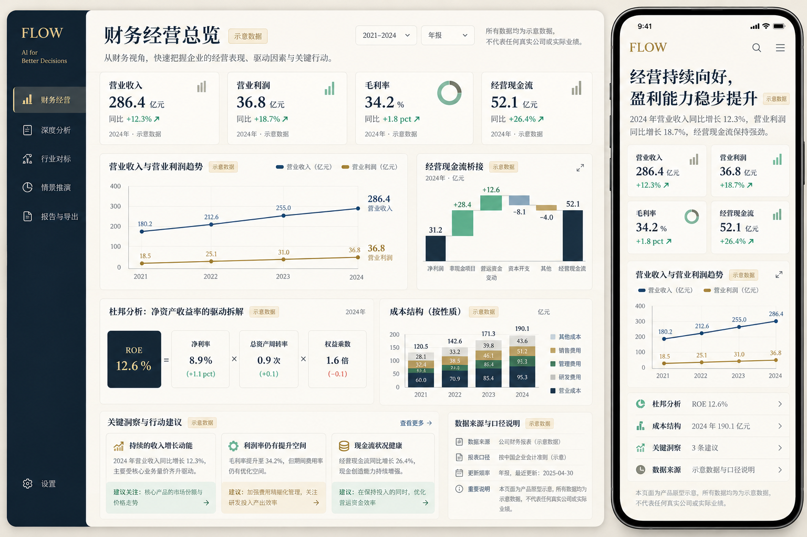

<sub><strong>概念稿 · 2026-10-18</strong>　A「高管编辑部」× C「财务报告画布」｜指标均为示意数据，页面与功能不代表当前实现状态。</sub>

</div>

FLOW 的视觉方向已经明确，接下来的工作是在单机原型边界内，把有来源、有口径、有解释的财务事实变成一张能阅读、能追问、能复核的分析画布。概念板负责展示设计目标；下面的实景截图记录此前真实运行过的页面和公开财报实验，两者分开呈现。2026-10-20 起，驾驶舱视觉重新进入全视图收敛：当前截图仅作历史基线，主题模块与数据工作台的最新实测仍保存在本机临时目录；截图自动化与截图资产发布流程继续暂停，待视觉验收收敛后再更新可发布截图。

<table>
<tr>
<td width="50%"><strong>经营驾驶舱 · 真实页面</strong><br/>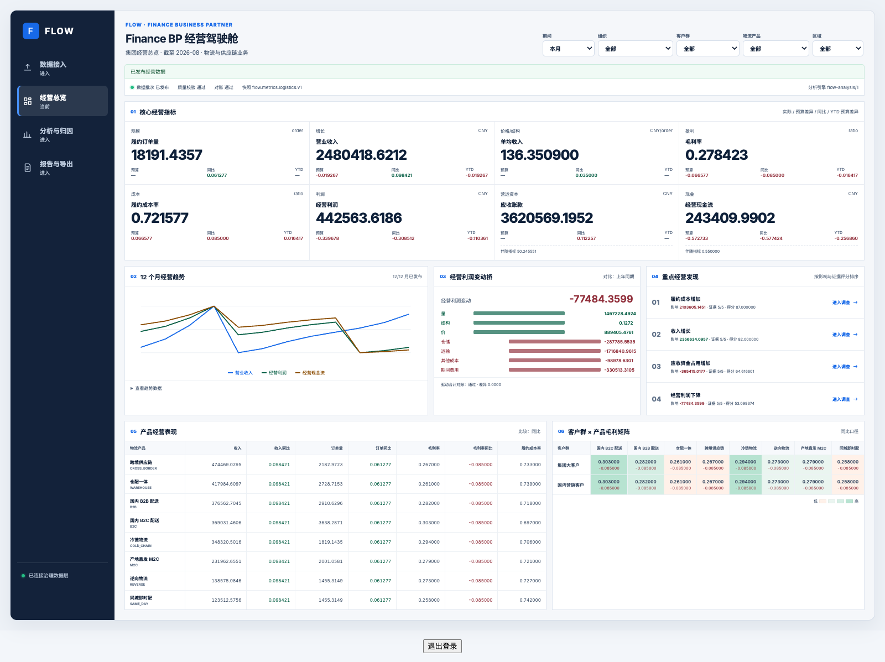<br/><sub>真实浏览器截图｜代码基线 c1a59d1｜确定性物流演示数据，非客户数据。保留旧版外观，不能视为当前完成态。</sub></td>
<td width="50%"><strong>公开财报 · 顺丰 2026Q1</strong><br/>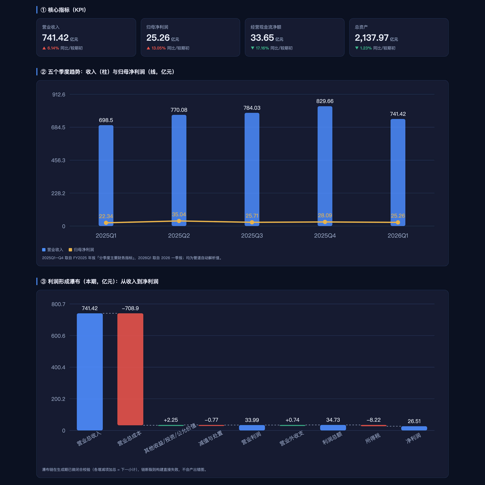<br/><sub>真实公开披露数据的静态分析报告画面｜原文抽取、勾稽验证和生成期闭合记录见下文。</sub></td>
</tr>
<tr>
<td width="50%"><strong>从异常回到证据</strong><br/>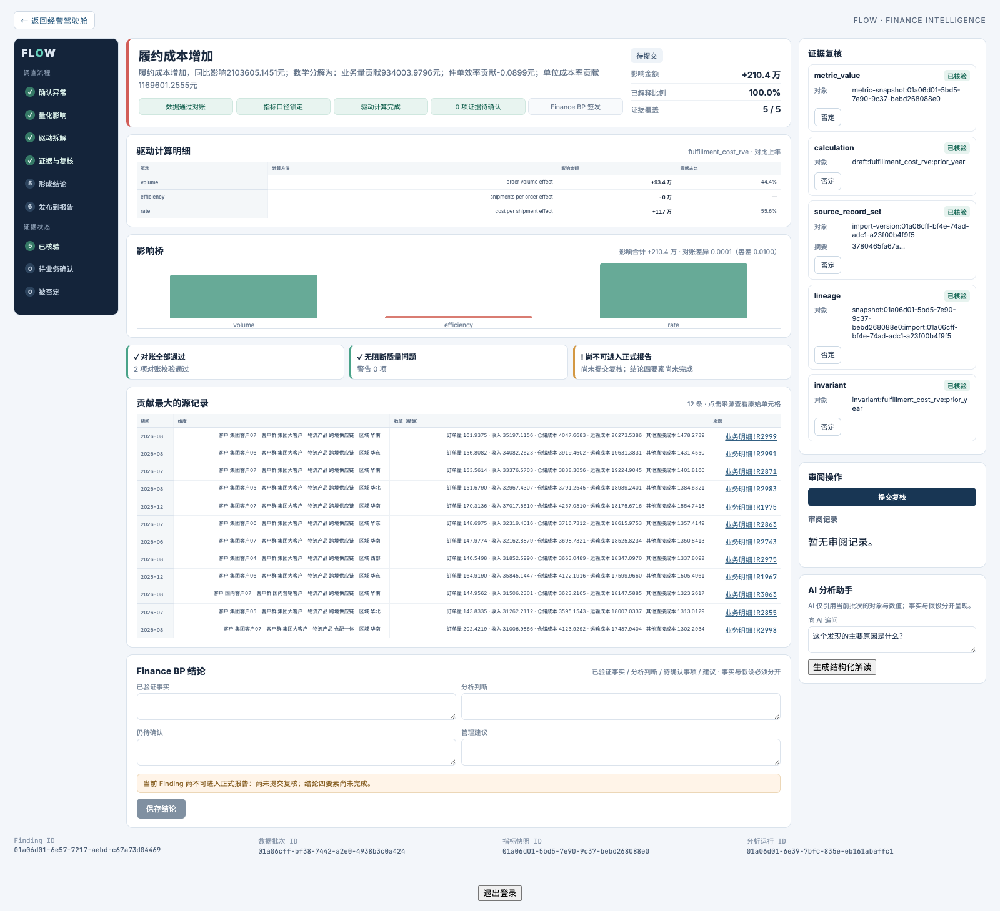<br/><sub>浏览器实测页面｜演示数据｜用于展示证据追溯交互。</sub></td>
<td width="50%"><strong>离线知识资产 · 可直接浏览</strong><br/>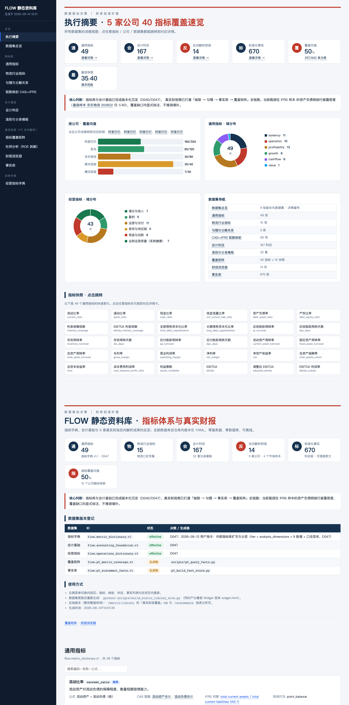<br/><sub>项目内静态资料库｜单文件、无需服务｜内容与发布版本见知识治理章节。</sub></td>
</tr>
</table>

### 当前 A+C 驾驶舱 · 真实页面实测

下面是概念板方向已经落到产品页面后的本机浏览器实测。桌面总览优先呈现营业收入、营业利润、毛利率和经营现金流；完整趋势、现金流桥、杜邦分解、费用结构、行动项及来源口径均可在同一画布查看。手机截图展示同一数据视图的窄屏排列。

2026-10-24 起，项目正在把 A「高管编辑部」× C「财务报告画布」抽象为可复制的 [FLOW Visual Language 包](packages/flow-visual-language/README.md)，并分阶段统一全项目页面、图表与报告输出。下图是本轮生产构建的真实页面截图；隔离 synthetic 数据，不代表真实企业经营结果。代码 SHA `9cf65f6d58e0cdb33d8e04c17d843a8c9bbc1489` 下 20 路由×3 视口矩阵 60/60 内容就绪、API 零错误、无横向溢出及浏览器错误。逐图表、交互状态、无障碍与各类报告打印仍在验收。完整记录：[视觉覆盖报告](docs/60_delivery/verification/2026-10-24--flow-visual-language-coverage-v1.md)；60 张截图和准确代码 SHA `9cf65f6d58e0cdb33d8e04c17d843a8c9bbc1489` 见[矩阵目录](docs/60_delivery/verification/visual-language-20261024/)。

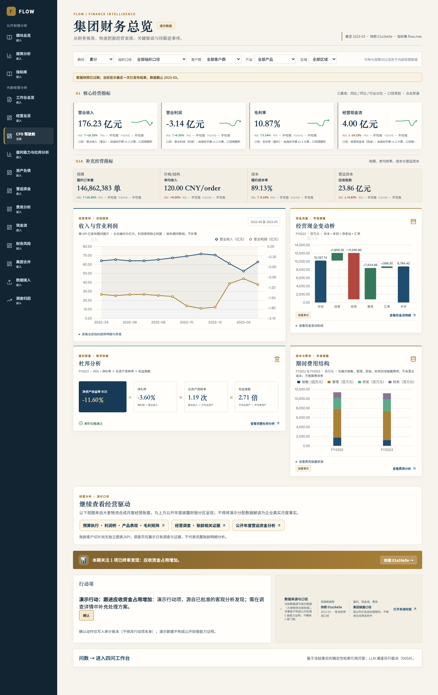

<table>
<tr>
<td width="50%"><strong>集团财务总览 · 桌面全页</strong><br/><br/><sub>真实页面｜1440 px 视口｜大麦物流合成演示数据。</sub></td>
<td width="50%"><strong>集团财务总览 · 手机全页</strong><br/>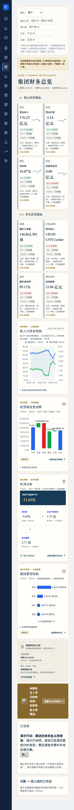<br/><sub>真实页面｜390 px 视口｜同一演示数据与代码版本。</sub></td>
</tr>
<tr>
<td width="50%"><strong>盈利能力与杜邦分析 · 桌面全页</strong><br/>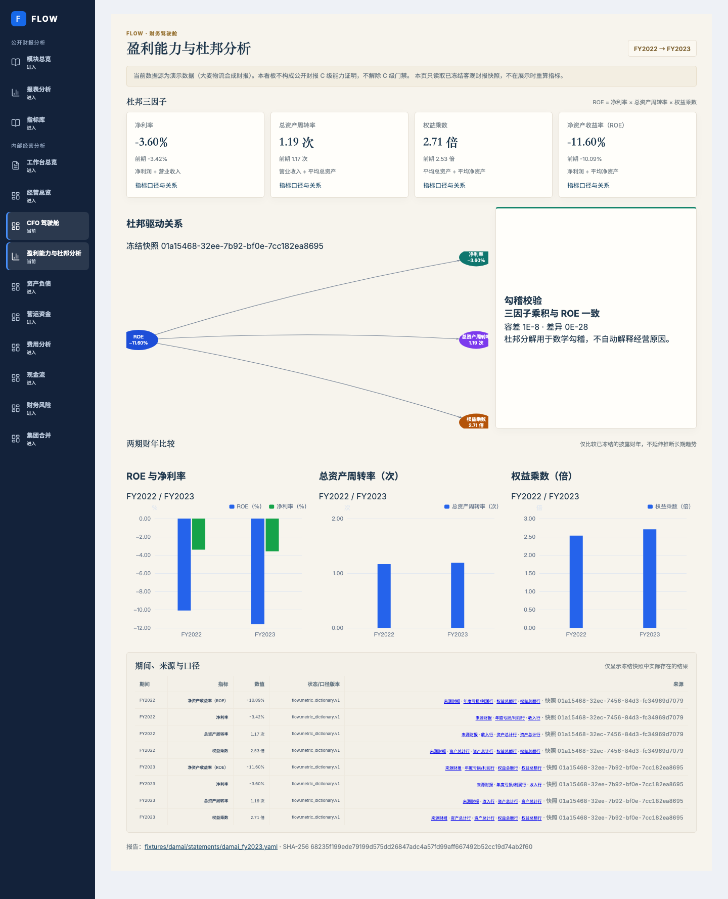<br/><sub>真实页面｜1440 px 视口｜财报快照、指标关系和来源行可追溯。</sub></td>
<td width="50%"><strong>验收口径</strong><br/>9 个 CFO/数据路由通过 1440 px 与 390 px 图表绘制和溢出检查；总览四项 KPI 趋势明细逐项与 API 对账。此组图片为当前产品页面，不是概念稿；数字来自隔离的大麦物流合成发行包，不是阿里、菜鸟或真实客户财报。</td>
</tr>
</table>

<div align="center"><sub>实景截图核对与操作边界见 <a href="docs/assets/screenshots/README.md">截图说明</a>。旧版产品截图不是当前视觉验收证据；概念图也不替代真实页面交付。</sub></div>

### 单机运行成果与离线驾驶舱

下图与离线报告来自 2026-10-20 的本机生产构建，代码 SHA `9ec0611562569b33bc3dac28c16445aa9470b150`。它们使用隔离目录中的大麦物流**合成演示批次**（manifest SHA-256 `6f3ef9176aaa02009c36080621d40ff6212ab1189c6e2c0695f5ea5f1b688fed`），验证报告 19/19 通过；不可将这些数据当作阿里巴巴、菜鸟或真实客户披露数据。

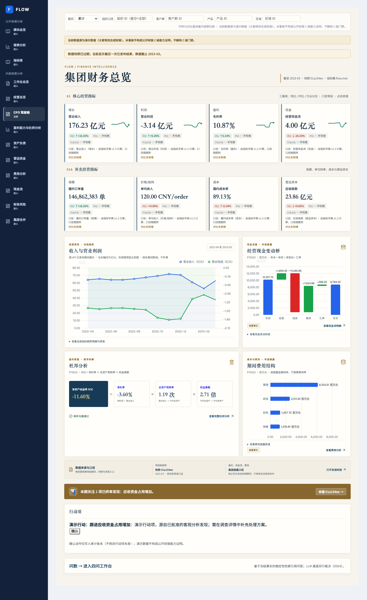

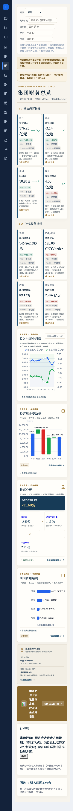

| 可直接查看的交付 | 内容 |
| --- | --- |
| [离线静态驾驶舱 HTML](docs/assets/screenshots/cockpit-single-machine/offline-preview.html) | 单文件、自包含图表和数据快照；可断网打开，快照内嵌来源与代码版本信息。离线版适合阅读和展示，动态筛选与页面跳转仍通过本地应用提供。 |
| [盈利能力与杜邦分析截图](docs/assets/screenshots/cockpit-single-machine/profitability-desktop-2026-10-20.png) | 实际页面全页截图。 |
| [截图与单机验收说明](docs/assets/screenshots/README.md) | 视口、数据批次、哈希、截图和离线检查结果。 |

本批静态文件以 `file://` 浏览器实测，外部请求为 0、页面错误为 0；生产应用由本机 SQLite 与文件目录驱动。完整命令和当前 GitHub CI 状态以[路线图](docs/50_plans/CURRENT_ROADMAP.md)及[验收记录](docs/60_delivery/verification/2026-10-20--single-machine-visual-static-acceptance-v1.md)为准。

> 长期产品方向遵循 [D052–D054](docs/10_governance/DECISION_INDEX.md)；当前交付边界由 [D055](docs/10_governance/decisions/D055--单机单用户验证原型.md) 定义为单机单用户财务分析验证原型。最新状态、实际执行位置与验收证据以 [唯一当前路线图](docs/50_plans/CURRENT_ROADMAP.md) 为准。

## 🎨 当前视觉设计基准

### 高管编辑部 × 财务报告画布

FLOW 后续驾驶舱与报告页面统一采用 **A「高管编辑部」主风格 + C「财务报告画布」叙事方式**。上方首屏呈现的**A+C 桌面与手机布局概念板**用于明确页面结构、图表类型和视觉气质；它是静态设计验证页面，不是当前产品运行截图，也不代表这些页面功能已经实现。图中指标数值均为**示意数据**，不能作为企业经营事实引用。

概念板已放在页面首屏，供读者先建立视觉印象；本节保留可执行的视觉原则与逐页验收口径。

可跨项目复用的视觉语言资产现已开始在 [`packages/flow-visual-language/`](packages/flow-visual-language/README.md) 沉淀：语义颜色/字体/间距 token、CSS 导出、页面与图表表达范式，以及无业务数据 specimen。全路由阶段验收与截图索引见[视觉覆盖记录](docs/60_delivery/verification/2026-10-24--flow-visual-language-coverage-v1.md)；该记录会随当前实施更新，截图是当前代码阶段证据，不代表全项目视觉收敛已经结束。


| 视觉层 | 统一标准 | 页面落实方式 |
| --- | --- | --- |
| 主风格 | 暖白与浅纸色作为分析画布，墨蓝建立标题、导航和信息层级，克制的金色强调结论，翡翠绿与砖红表达正负变化 | 保持专业、稳重、高级；用字体层级、留白、网格和精细边界建立质感，不依赖大幅装饰图、发光渐变或无意义纹理 |
| 报告叙事 | 结论先行，再展示支持图表、关键口径、期间、来源和需要关注的事项 | 把报告组织成可连续阅读的分析画布；读者能从结论顺着图表回到指标定义和原始披露 |
| 图表密度 | 每个分析视图都要有与主题匹配的趋势、构成、比较或驱动拆解 | CFO 总览展示收入、营业利润、毛利率、经营现金流趋势和行动项；盈利页展示利润率与杜邦分解；费用、资产负债、营运资金、现金流、风险和集团视图分别展示可被数据支持的结构和变化 |
| 数据真实 | 图表数值必须来自已验证的公开财报、标记清楚的演示数据或可重复计算的指标 | 缺少数据时呈现缺口及原因，不补零、不造趋势、不用图片遮盖空白；每张图同时给出可核对的数值表或数据摘要 |
| 指标可读 | 指标显示名称、期间、单位、比较基准、数据类型和来源状态 | 订单量等计数使用整数；金额显示两位小数；百分比使用明确精度；颜色之外同时使用文字、符号或图例解释变化 |
| 交互追溯 | 页面中的 KPI、图表、表格、行动项和报告结论之间建立明确的下钻与返回路径 | 点击数据可继续查看公式、指标定义、明细构成、Finding、报告来源行或原始证据；交互不能丢失期间与数据批次上下文 |
| 响应式与无障碍 | 桌面和手机都能阅读数值、比较关系与图表图例 | 按 1440 px 桌面和 390 px 手机视口核验，不横向溢出；用足够对比度、键盘可达焦点和非颜色提示表达状态 |
| 成熟组件复用 | 优先扩展项目已采用的 ECharts 和现有筛选、表格、来源披露组件 | 只有现有成熟能力无法满足且经维护状态、许可、兼容性、安全与成本评估后，才引入新依赖或自研 |

**后续验收规则：** 设计概念图只定义方向，不能替代真实页面验收。每次交付须使用真实运行页面截图，标明代码提交、视口、数据来源/演示批次与采集日期；截图中的数字必须能回到页面数据或接口。每个视图均须核对图表与 API/指标口径一致、缺数状态清楚、核心数字可追溯、关键交互可操作。视觉目标和逐阶段验收以 [D055 决策](docs/10_governance/decisions/D055--单机单用户验证原型.md)、[单机原型视觉设计规格](docs/superpowers/specs/2026-10-18-single-machine-visual-prototype-design.md)与[当前实施工作包](docs/50_plans/work_items/FLOW--single-machine-visual-prototype.md)为准；README 中真实截图与概念图必须分别标注。

## 🏛️ 三层两模块：产品结构一图

项目的目标结构（[D053](docs/10_governance/decisions/D053--三层两模块边界与执行顺序.md)）——**可见的专业治理底座 + 共享分析底座，支撑两个面向不同受众的模块**：

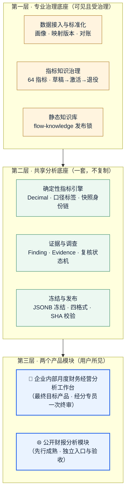

> 两模块**共享同一底座与数字身份链**，区别只在数据定义与验收口径；公开模块先行成熟（14 份真实财报已验证），内部工作台待数据授权与四级验证。

## 🎯 FLOW 解决什么问题

财务经营分析专员（经分专员）的月度工作通常横跨多份 Excel：业务量、收入与履约成本、财务实际、预算、应收和现金。FLOW 将这些文件转换为有版本、有质量检查、有血缘的数据，再由确定性引擎与 AI 角色协同完成标准扫描、调查、Finding 和双版本报告；经分专员一次终审后正式发布（[D052](docs/10_governance/decisions/D052--内部月度财务经营分析工作台成为核心产品.md)、[D054](docs/10_governance/decisions/D054--AI生产链与证据计算学习原则.md)）。

项目长期方向是 Finance Intelligence OS。目标结构为**三层两模块**（[D053](docs/10_governance/decisions/D053--三层两模块边界与执行顺序.md)）：可见的专业治理底座 + 共享分析底座，支撑**企业内部分析工作台**（最终目标产品）与**公开财报分析模块**（先行成熟底座、独立入口与验收）。U8 与 S01 已完成；当前交付边界和顺序由 D055 收敛为单机单用户验证原型，先验证 SQLite 与本地文件存储，再简化运行结构并完成全视图视觉验收。旧 U9/U10 任务按 D053 重新裁决。固定产品原则见 [PRODUCT_PRINCIPLES](docs/20_product/PRODUCT_PRINCIPLES.md)。

<details open>
<summary><strong>六类工作问题 → 可复核的结果</strong></summary>

| 工作问题 | FLOW 的处理方式 | 可复核的结果 |
| --- | --- | --- |
| 工作表名称、列顺序、字段格式不一致 | 工作簿画像、别名映射、人工覆盖、版本化转换 | 映射版本、源文件 SHA、原始值与转换事件 |
| 业务收入与财务收入对不上 | 发布前质量检查与跨域对账 | 阻断项、警告确认原因、对账结果 |
| 页面数字与报告数字不一致 | 指标口径版本 + 指标快照 + 冻结报告内容 | 同一身份链、精确数值和计算轨迹 |
| 异常解释缺少证据 | 驱动贡献、公式、源记录、证据复核 | Finding、Evidence、Conclusion、追加式审阅事件 |
| AI 文字难以审计 | 受约束上下文、对象引用、数字一致性检查 | 结构化回答、降级原因、持久化交互记录 |
| 原报告重导出后内容发生变化 | 冻结完整 JSONB 视图，导出仅读冻结内容 | 稳定报告版本、独立发布尝试与下载校验 |

</details>

## 🗺️ 一张图理解工作流

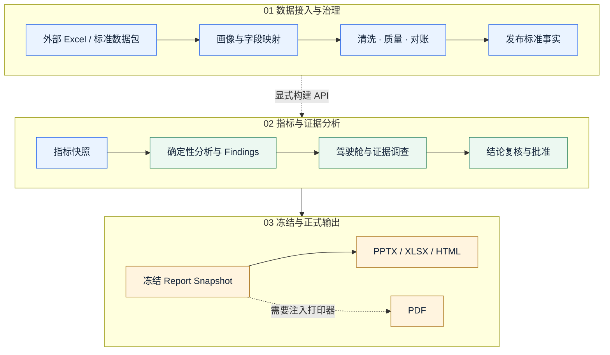

实线表示已有领域处理关系；虚线标出尚需显式编排或部署集成的环节。当前“发布导入版本”只发布标准事实，**不会自动启动该批次的指标计算与分析运行**。已提供 `POST /api/v1/orchestration/batches/{id}/build`，按批次期间同步构建并保留任务状态；公开财报浏览器闭环仍按下一阶段验收。

## 🖥️ 界面导览

当前浏览器入口：`/`（驾驶舱）、`/data`、`/investigations`、`/reports`、`/statements`、`/metric-library`、`/operations`、`/login`。现有页面仍按历史双轨结构（D045，已被 [D053](docs/10_governance/decisions/D053--三层两模块边界与执行顺序.md) 取代）组织：**「数据层」两轨共用**；**「财务分析」轨**（驾驶舱、归因、报告、报表分析、指标库）；**「经营分析」轨**（`/operations` 只读演示页）。全部功能页共享同一左侧工作流导航。主导航与工作流的大规模改造由当前 S01 按三层两模块目标结构推进。

### 1. Finance BP 驾驶舱

首页汇集八个核心指标卡、12 个月趋势、经营利润变动桥、重点 Findings、产品表现表和客户群 × 产品毛利矩阵。筛选维度包括期间、组织、客户群、物流产品和区域；进入调查时携带批次、指标快照和分析运行身份。

> 物流执行子集原有 15 项、首页八项；财务知识库现有 **64 项**定义（指标库 v1.1），登记数不等于任意财报可算数。

### 2. 数据工作台：把文件转换为可发布数据

流程为 **准备 → 上传与画像 → 映射确认 → 清洗与校验 → 发布**。

- 支持标准工作簿与非标准物流示例工作簿；
- 人工覆盖提交真实源文件 SHA，确认后继续使用已持久化的映射版本；
- 清洗结果显示转换、质量问题和财务对账；警告必须填写确认原因，阻断项和未通过的对账必须处理；
- 发布后可下载标准化 XLSX，用于核对与交换。

<details>
<summary><strong>展开：字段映射与清洗校验界面</strong></summary>

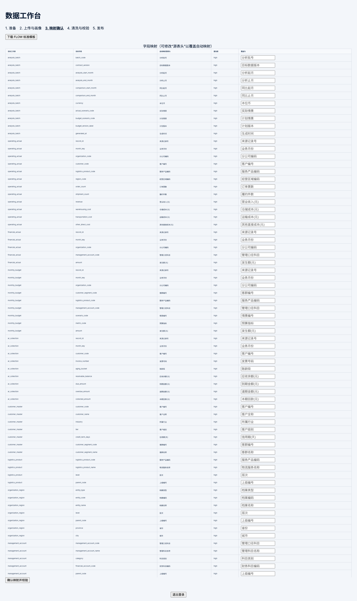

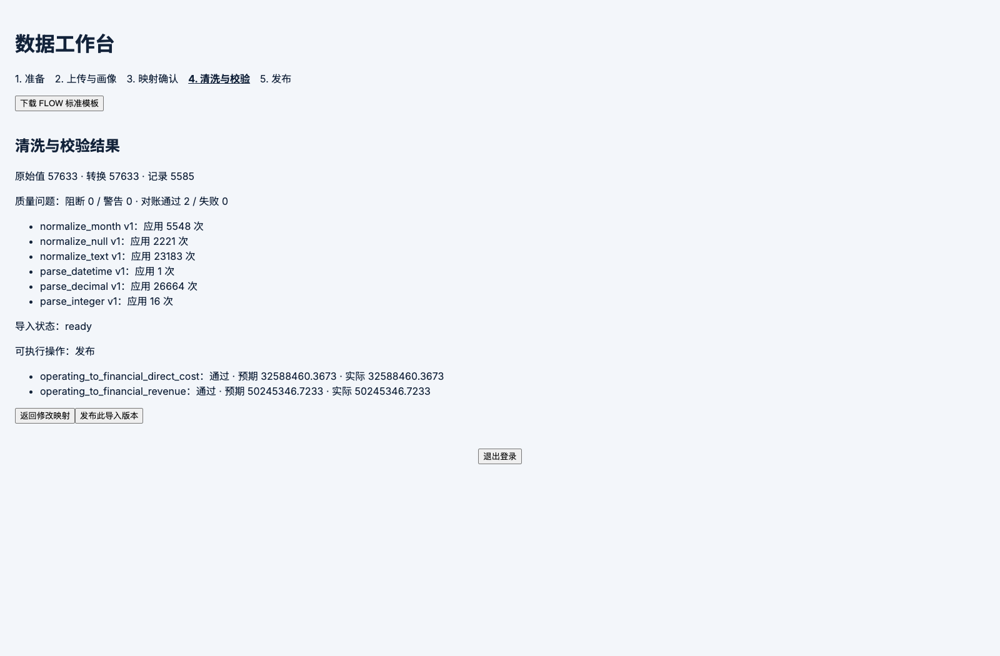

</details>

### 3. Investigation：从发现回到证据

调查页提供异常定义、影响金额、驱动桥、计算明细、对账与质量状态、源记录、公式和数据血缘。结论分为**已验证事实、分析判断、待确认问题、建议行动**；批准由状态机控制。


**四问工作台的回答闭环**（U7 已交付，方法论权威见知识卡 METHOD-QA-001）——每个异动都走完同一条可审计的递进链：


批准后的证据若被拒绝，或结论被修改，Finding 会退回复核并留下事件记录；没有证据的 Finding 不能批准。已冻结报告保留签发时内容，新的报告版本重新检查当前资格。

### 4. 报告中心：冻结、生成、追踪与下载

报告中心可以冻结已发布指标快照中的批准 Findings，选择报告版本和输出格式，查看各次生成尝试并下载成功产物。冻结表单已提供可视化快照候选选择器；下图为较早版本，不能用于判断最新交互。

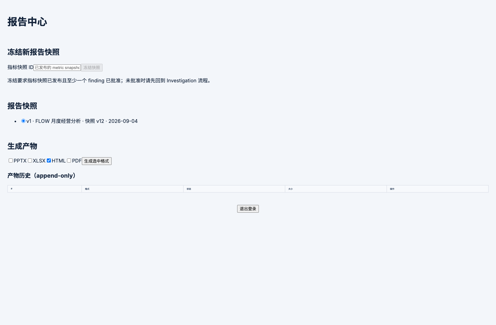

<details>
<summary><strong>展开：登录入口与移动端工作台</strong></summary>

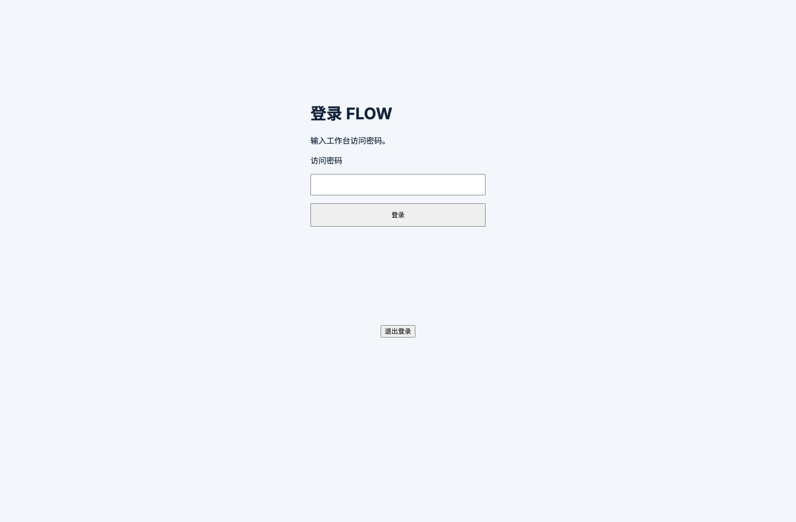


</details>

截图环境、数据来源和操作记录见 [界面截图说明](docs/assets/screenshots/README.md)。

## 📊 真实财报图形化分析

项目用真实公开财报验证「准确性承诺」（[D041/D042](docs/knowledge-base/04_decisions/DECISION_LOG.md)）：管道自动抽取财报 PDF 中的报表行项目，经勾稽与跨文档比对后重建四表一注，并以同一批冻结数据生成图形化分析。**所有图表在生成期做闭合校验，数字零手工调整；口径差异与披露缺失显式标注，不推测填补。**

目前已完成 **5 家公司、14 份报告**的反向解析并全部导入系统（`statement_report` / `statement_line_item`），在 **`/statements` 报表分析页**按报告切换呈现 KPI 卡、利润形成瀑布、资产/资本结构环形、现金流三活动柱状、现金桥与四表全量行项目；数值保持披露原值与单位，展示层只做单位缩放，溯源到原文 SHA-256：

| 公司 | 报告 | 准则 | 行项目 | 勾稽验证 |
| --- | --- | --- | --- | --- |
| 顺丰控股 002352.SZ | 2026 一季报 | CAS | 163 | 报表内 20/20；跨文档 12/12 |
| 腾讯控股 0700.HK | 2026 Q2 业绩公告 | IFRS + Non-IFRS | 20 | 分部加总、毛利链、IFRS→Non-IFRS 调节链全闭合 |
| 京东物流 2618.HK | FY2025 年报 | IFRS | 118 | IFRS 勾稽 24/24（两期全验） |
| 阿里巴巴 9988.HK | FY2019–FY2026 八份年报 | IFRS（US GAAP 口径披露） | 52–53 × 8 | 八年连续期间序列 |
| 菜鸟集团（未上市） | FY2021–FY2023 招股书申报稿 | IFRS | 105 × 3 | 招股书三期连续 |

重建数据库后执行 `bash scripts/seed_p5_statements.sh` 即可幂等恢复全部 14 份报告（同时幂等补齐本地开发所需的 service_account 身份绑定，否则启用 `AUTH_TOKEN` 后 API 一律 401）。抽取产物与验证记录见 [docs/implementation/p5](docs/implementation/p5/P5-validation-summary.md)。

### 指标覆盖矩阵与事实库（P5 Facts V1）

14 份报告的抽取行项目经 [item_alias_map](docs/implementation/p5/item_alias_map_v1.yaml)（CAS/IFRS 行名 → 标准科目，含 `#n` 重名消歧与组合映射）归一化为 **670 条科目事实**（[statement_facts.yaml](docs/implementation/p5/statement_facts.yaml)，670 事实 / 630 条有意未映射的口径不纯行全部留痕），并由 `python3 scripts/p5_query_facts.py` 计算 **40 个通用指标 × 15 个公司期间快照**的可计算覆盖矩阵（[metric_coverage_matrix.md](docs/implementation/p5/metric_coverage_matrix.md) + 机读数据集 [p5_metric_coverage_v1.yaml](config/metrics/p5_metric_coverage_v1.yaml)）：顺丰 2026Q1 35/40、京东物流 FY2025 29/40、菜鸟 FY2022–23 26/40、阿里巴巴多数年度 22/40、腾讯单季 7/40；每个缺口格子都带首个缺失科目原因（如「缺 bs.ar(end)」），口径约定（avg=（期末+期初）/2、单季未年化、绝对额已换算亿元）随数据集下发。在线入口：`/metric-library` 页的「真实财报覆盖」tab（只读端点 `GET /api/v1/metric-library/coverage`）。

### 静态资料库：离线浏览全部静态内容（零服务器 / 零数据库）

所有版本化静态数据集打包为单文件离线站点 **[docs/library/index.html](docs/library/index.html)**（约 485 KB，双击即可用浏览器打开，file:// 直开、无需任何服务）：左侧菜单、右侧内容，覆盖 数据集总览、通用指标 49 项、物流行业指标 15 项、勾稽与分解关系、CAS↔IFRS 取数映射 28 项、会计科目 167 个、准则登记册与分录模板 32 套、指标覆盖矩阵、14 份财报原文表格浏览器（公司/期间切换）、670 条事实库（按公司/报表筛选）、经营指标字典。数据集更新后重新生成：

```bash
python3 scripts/build_static_library_site.py
```

### 顺丰控股 2026Q1：四表可视化分析

从 2026 一季报原文抽取 **163 个报表行项目**（报表内勾稽 20/20、与 FY2025 年报跨文档比对 12/12 一致），生成十个板块的分析视图：


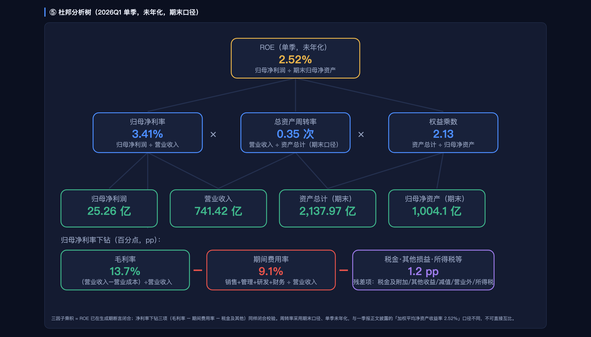

<details>
<summary><strong>展开：结构堆叠、同业对比与现金流板块</strong></summary>

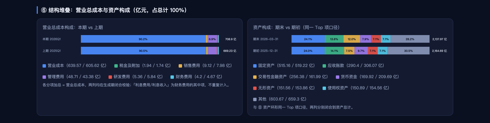

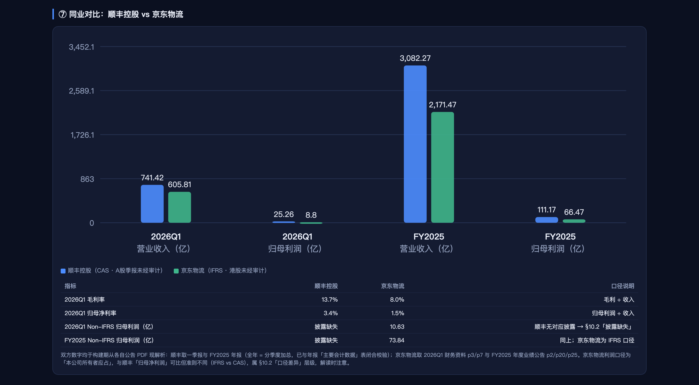

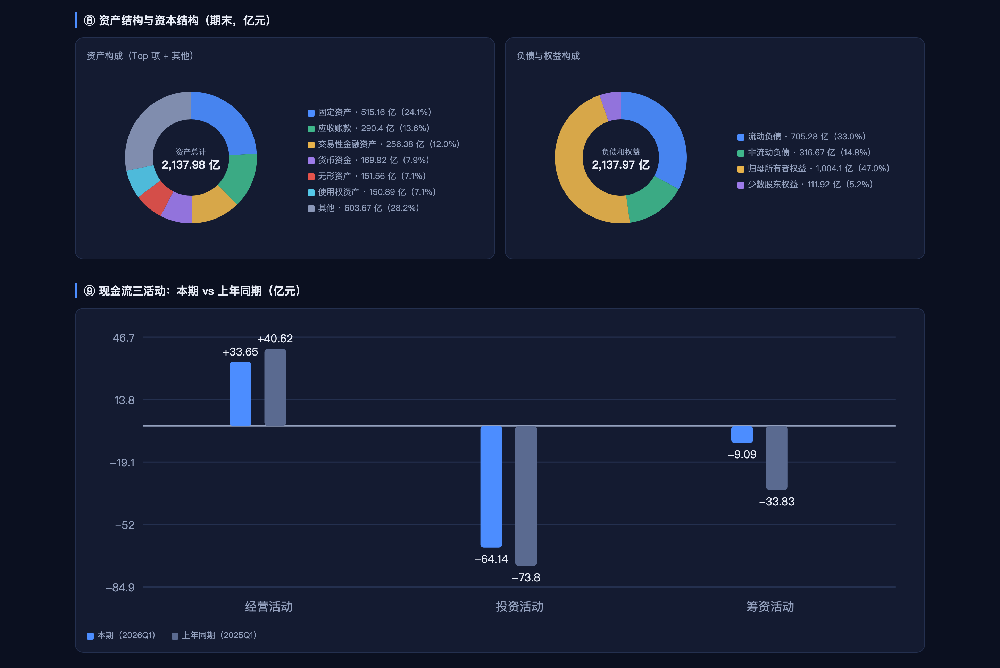

</details>

完整交互页面：[sf_2026q1_report_view.html](docs/implementation/p5/sf_2026q1_report_view.html)；差异比对记录：[sf_2026q1_diff_report.md](docs/implementation/p5/sf_2026q1_diff_report.md)；验证证据：[P5 首次抽取验证记录](docs/implementation/2026-09-05-p5-first-extraction.md)。

### 腾讯控股 2Q2026：IFRS → Non-IFRS 调节分析

同一生成器复用于港股 IFRS 样本：从业绩公告抽取三期数据，重建简明综合收益表，并把 IFRS 归母盈利到 Non-IFRS 归母盈利的七项调节做成闭合瀑布（调节链与公告披露值交叉勾稽一致）。

> **2026-09-08 修复**：利润表归一化映射补入「投资收益净额及其他」等三行后，逐行加总与除税前盈利 **696.90 亿**完全闭合，并有守恒锁定测试守护（`08cfa5c`）。

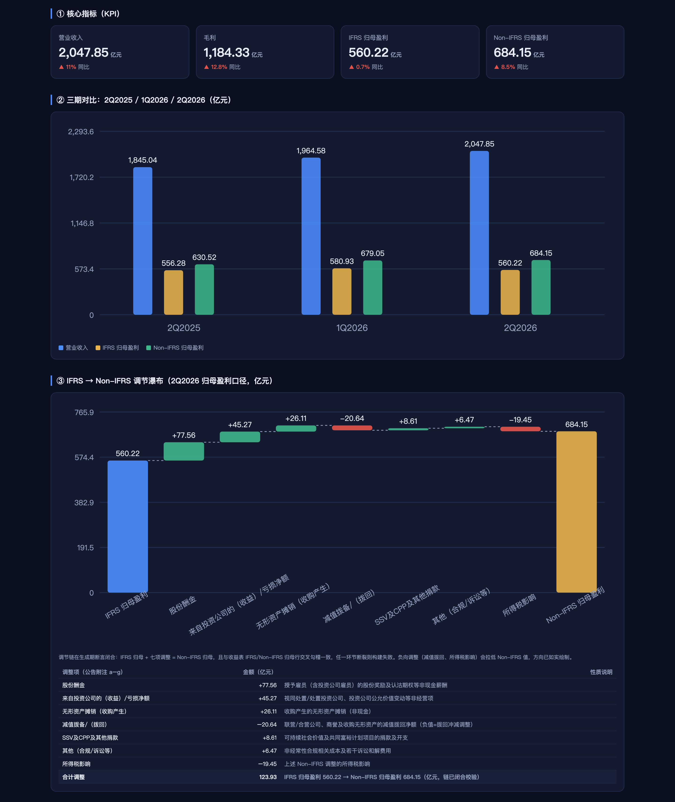

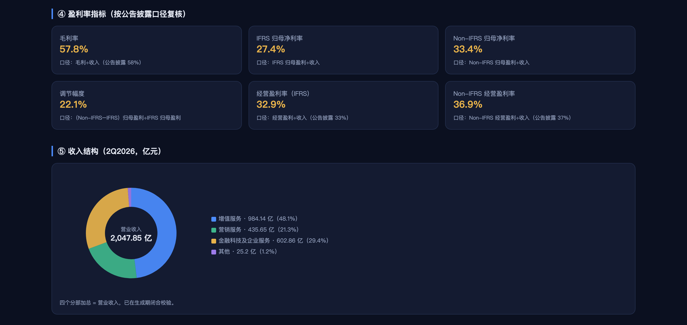

完整交互页面：[tencent_2026q2_report_view.html](docs/implementation/p5/tencent_2026q2_report_view.html)。

### 京东物流、阿里巴巴与菜鸟：IFRS 样本扩展

同一条「抽取 → 勾稽 → 落库 → 图形化」链路复用到更多 IFRS 样本：京东物流 FY2025 年报 118 个行项目（IFRS 勾稽 24/24）；阿里巴巴 FY2019–FY2026 连续八份年报（每年 52–53 行，构成八年期间序列）；菜鸟集团招股书申报稿 FY2021–FY2023 三期（每年 105 行）。这些报告全部可在 `/statements` 页面切换查看；IFRS 繁体/简体行名与千元/百万元单位差异由视图层按披露单位缩放与命名适配处理，缺失关键行的报告不伪造图形。

### 指标库 v0 评审台

配合 [D040 指标库立项](docs/superpowers/specs/2026-09-05-flow-metric-dictionary-design.md) 的可视化评审工具：通用 40 指标 + 物流行业 15 指标 + 会计基础数据（164 科目、28 项 CAS↔IFRS 取数映射）逐项「纳入/待定/剔除」评审，勾稽关系与杜邦分解树内置展示。

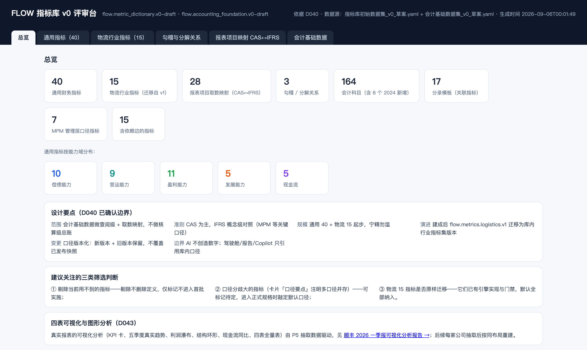

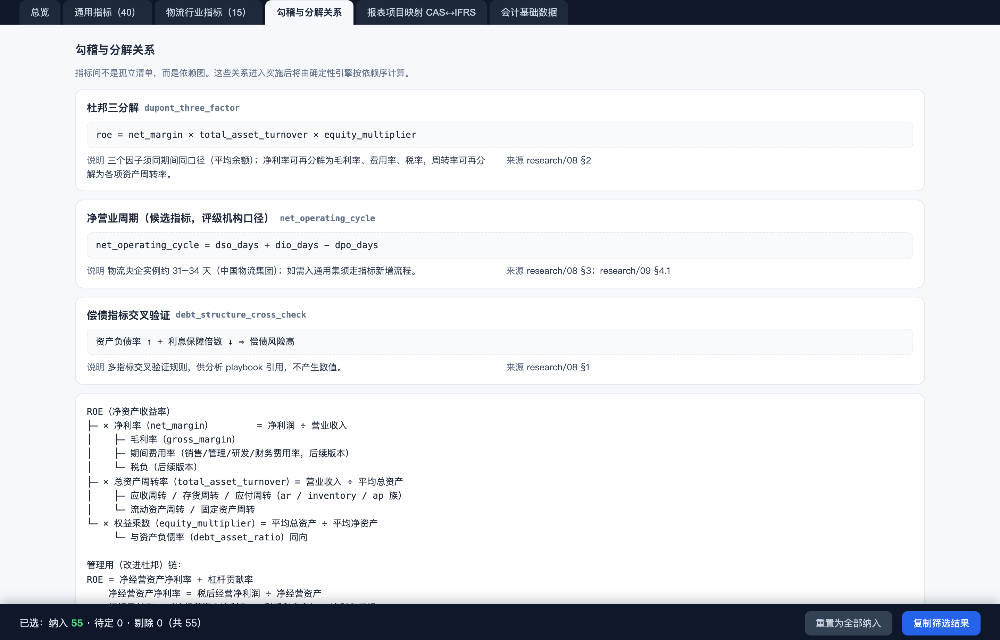

**指标治理生命周期**（C01–C06 已交付）——每个指标定义从登记到退役全程可追溯，目标值与预警阈值同版本管理：

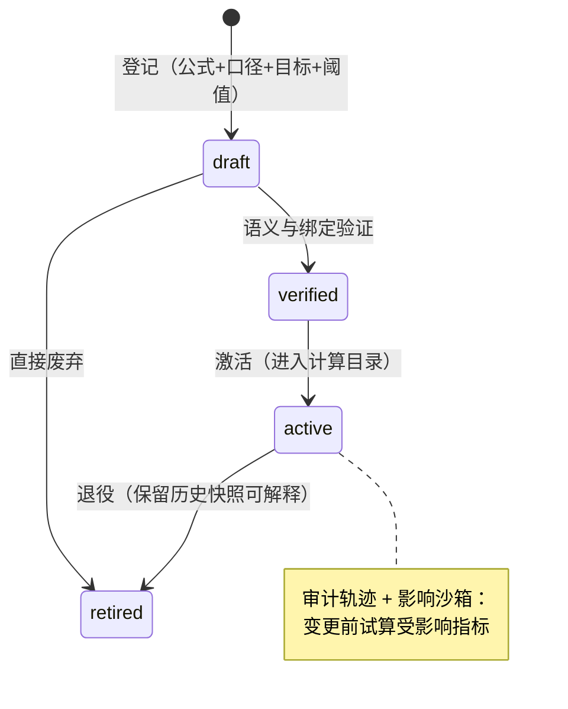

评审台页面：[metric-library-v0-review.html](docs/knowledge-base/03_assets/visual_prototypes/metric-library-v0-review.html)。以上截图由 [capture_p5_report_screenshots.mjs](scripts/capture_p5_report_screenshots.mjs) 从报告页面机械截取，未做拼接或修饰；图片来源与采集方式见[截图说明](docs/assets/screenshots/README.md)。

## 📚 静态知识治理：项目自己的知识生产线

产品口径不依赖动态外部笔记——**全部正式知识以版本化发布锁定在仓库内**（`flow-knowledge-2026-09-12.1`，31 项资产逐项 SHA-256）：

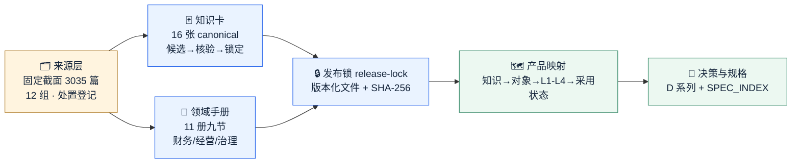

- **来源登记**：12 组来源与冻结截面声明完全对账；篇级按需登记，不伪造路径；
- **转换门禁**：外部文章不得直接成为需求——必须经知识卡 → 产品映射 → 正式决策三道门（CI 强制校验）；
- **离线资料库**：全部静态数据集打包为单文件站点（双击即开、零服务器）：


信息架构与界面设计的可交互原型（设计期产物，见 `03_assets/visual_prototypes/`）：

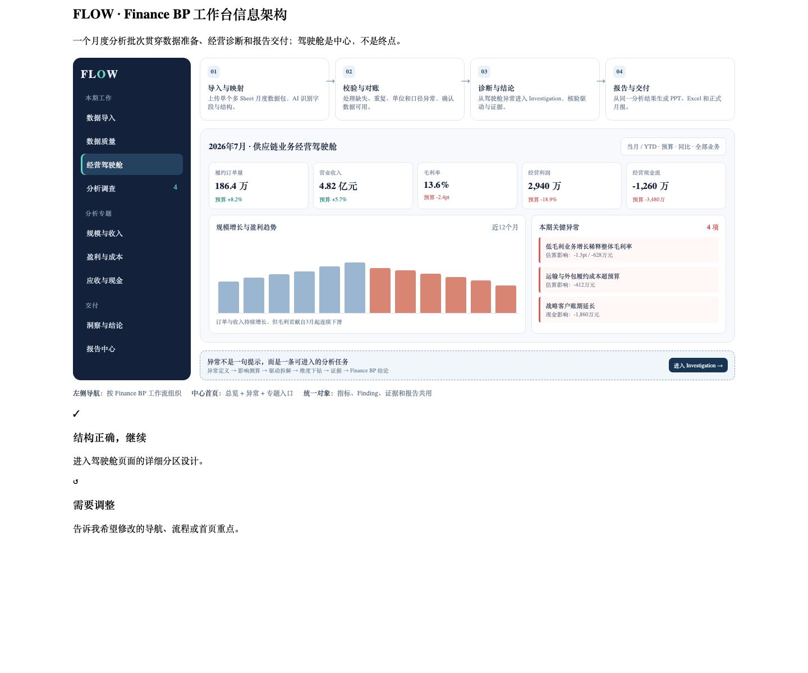

## 📍 当前进度

状态以 [CURRENT_ROADMAP](docs/50_plans/CURRENT_ROADMAP.md) 为唯一权威。长期产品战略由 D052–D054 定义；当前产品交付边界按 [D055](docs/10_governance/decisions/D055--单机单用户验证原型.md) 聚焦单机单用户财务分析验证原型。驾驶舱视觉与架构改造的队列、验收和 CI 状态见[正式工作包](docs/50_plans/work_items/FLOW--single-machine-visual-prototype.md)。

| 阶段 | 任务 | 状态 |
| --- | --- | --- |
| 奠基 | Phase 1–10 窄切片 + Pilot + 双轮审查修复（R1–R9/N1–N3） | ✅ 已完成 |
| 真实验证 | P5 财报反向解析（顺丰 + 腾讯 + 京东物流 + 阿里巴巴八年 + 菜鸟三期，14 份报告已落库至 `/statements`） | ✅ 已交付 |
| 基线 | P00–P02 基线刷新、口径订正、主题/比较合同 | ✅ 已完成 |
| U1–U3 | 主题/比较合同、确定性拆解、同源证据与快照投影 | ✅ 已完成（U2 剩 2 项外部依赖登记中） |
| U4 | 独立全行验证与留出泛化（依赖 oracle 人工录入） | ⬜ 外部到料即并行 |
| U5–U7 | 客观报告门禁、统一冻结、四问工作台 | ✅ 已交付 |
| **U8** | 生产就绪收口（真实存储旅程、HTTPS 拓扑、统一部署验收） | ✅ completed；严格冻结门禁通过 |
| **S01** | 战略边界、Financial Facts V2、安全/RBAC/审计门禁 | ✅ completed |
| **D 轨** | 大麦物流完整财年演示数据、正式工作流与八页面 E2E | ✅ completed（verify 19/19、E2E 9/9、17 门禁绿；CI 全绿于 `d701c1d`） |
| **D055 原型交付** | 单机单用户、SQLite + 本地目录、A+C 驾驶舱/报告视觉升级 | ✅ 7a.1–7a.8 已完成并合入 main；PR #4 文档状态 merge commit `b068796f` 的准确 SHA run `40096497668` 为 28/28 success。原型限制见路线图与完结差距审查 |
| **当前队首** | 提炼可移植视觉语言并统一 FLOW 全项目页面、图表、报告与有效文档 | 🚧 用户已批准，现于 `codex/flow-visual-language` 实施。唯一顺序见路线图 |
| **K 轨** | 第二代静态知识刷新、sealed candidate 与战略重基线 | ⏭️ 排队；当前视觉语言任务之后再启动 K2 |
| U9–U10 | 内部试点、V1.1 证据决策 | ⏭️ 排队；依赖公开 C 级证据与真实企业数据，轮到后按路线图验收 |

已登记的确定性原语：CAGR（n−1 间隔）、可加和守恒桥（残差显式）、经验阈值提示（无普适判定）、口径标签值（登记制）、应收-收入增速联看提示。

## ⚙️ 能力与实现状态

| 模块 | 当前已实现 | 需要区分的边界 |
| --- | --- | --- |
| 数据接入 | 上传、画像、映射覆盖、清洗、警告确认、版本发布、标准化导出 | 任意新批次的指标/分析自动编排尚未接通 |
| 标准数据 | `flow.excel.v1`，10 张交换工作表，公共维度与主题事实 | Excel 是交换格式；单机原型以 `~/.flow/flow.sqlite3` 为业务数据权威源 |
| 指标引擎 | 物流 15 指标 + 知识库 64 指标定义（v1.1）、Decimal、月/YTD/预算/同比/T12 窗口 | 登记数不等于任意财报可算数 |
| 指标治理 | 定义、绑定、语义、草稿/验证/激活/退役、审计、影响沙箱和界面（迁移头 `0018_metric_governance`） | 既有字段审计不能证明所有会计分类正确 |
| 客观分析引擎 | `objective_finance_v1`：净现比、杜邦三分解（全链口径标注）等条目 + 五个确定性原语 | 数学分解不冒充业务因果；报告门禁在 U5 建设 |
| 分析引擎 | 5 个 typed Playbook、驱动对账、Finding 与 Evidence | 确定性政策与阈值，非自动学习模型 |
| 驾驶舱与调查 | 多维浏览、身份交接、证据复核、四要素结论、审阅历史 | 演示数据通过不替代真实客户试点 |
| Copilot | 上下文绑定、引用和数字校验、降级与持久审计 | 默认是离线 `DeterministicProvider`，尚无现成在线大模型适配器 |
| 报告发布 | 冻结内容、版本幂等、独立尝试、下载头与字节校验 | API 默认没有 PDF 打印器；PPTX/XLSX/HTML 产物保存在本地内容目录 |
| 认证 | 单用户密码、会话、服务端 Bearer、同源代理与 HTTPS 拓扑 | 多租户、复杂角色权限与 SSO 暂缓；保留本机登录保护和审计身份 |
| 任务执行 | 同步请求内运行，单机 API 启动时无需独立 Worker | 长耗时操作不由后台队列执行；状态记录与重试语义仍由业务流程负责 |

## 🏗️ 系统架构

### 运行组件

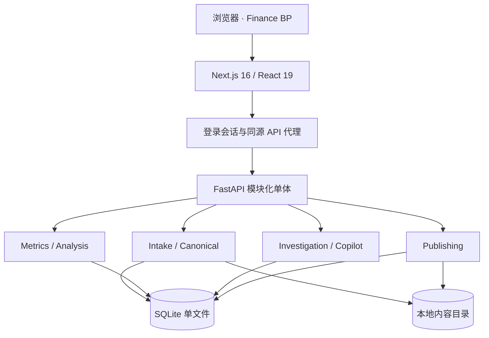

> 上图描述 D055 单机原型的普通运行路径。历史 PostgreSQL/Redis/MinIO Compose 仅用于兼容性测试，不属于用户日常启动依赖。

| 层 | 技术与职责 |
| --- | --- |
| Web | Next.js 16.3.3、React 19.2、TypeScript、服务端同源代理 |
| API | Python 3.13、FastAPI、Pydantic、SQLAlchemy、Alembic |
| 计算 | Python Decimal、数据库版本化指标目录与治理（D048 库内权威 + YAML 兼容），YAML 配置 |
| 文件 | openpyxl、python-pptx、HTML 渲染、可注入 PDF 打印器 |
| 存储 | SQLite 单文件、Decimal 定标存储、本地 SHA-256 内容寻址文件 |
| 工程 | pnpm 10.17.1、uv 锁文件、pytest、Vitest、Playwright、GitHub Actions |

版本以锁文件为准；系统是本机 Web/API 双进程的模块化单体，不启动独立 Worker。SQLite 与本地内容目录由同一数据根目录管理。详见[运行架构](docs/architecture/flow-v1-runtime.md)。

### 身份、血缘与冻结边界

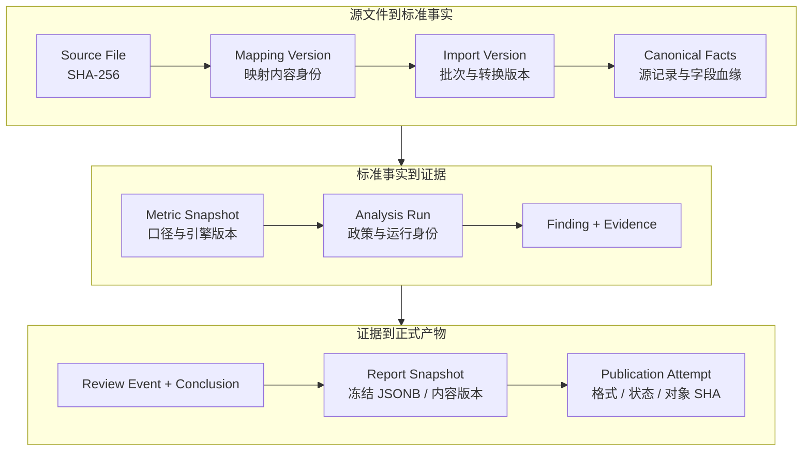

三个关键约束：

1. **源文件与原始值保留。** 映射和转换产生版本，修订不覆盖旧数据。
2. **财务数字由确定性引擎产生。** AI 与渲染器引用结果，不另算一套数字；同一指标不同口径必须携带口径标签（如杜邦分解「净利润总额口径·期末权益·未年化」）。
3. **正式报告读取冻结内容。** 内容不变复用报告版本；变化生成新版本；失败重试使用原冻结视图。

### 复核状态与报告资格

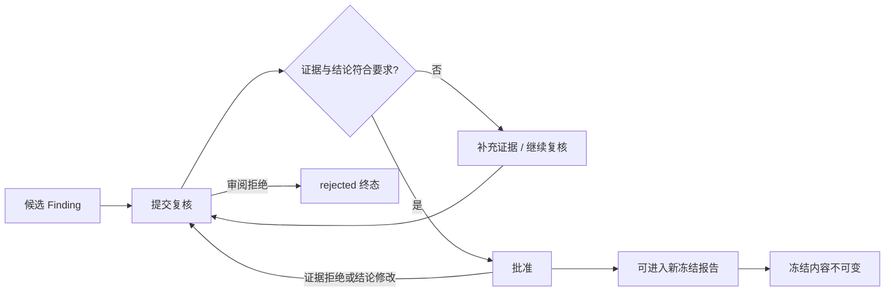

此图展示业务约束，精确状态和事件表见[领域对象](docs/architecture/flow-v1-domain-objects.md)。冻结与复核变更共享行锁，避免并发请求绕过资格检查。

## 📦 数据契约与分析口径

### 一个工作簿，十张标准工作表

| 工作表 | 内容 | 工作表 | 内容 |
| --- | --- | --- | --- |
| `00_填写说明` | 填写规则、口径和示例 | `05_应收回款` | 应收、回款、现金相关事实 |
| `01_分析批次` | 分析窗口、币种、实际和预算情景 | `06_客户主数据` | 客户与客户群 |
| `02_经营实际` | 订单、件量、收入、直接成本 | `07_物流产品` | 物流产品维度 |
| `03_财务实际` | 管理科目对应的财务实际 | `08_组织与区域` | 组织和区域共用维度 |
| `04_月度预算` | 月度预算与业务维度 | `09_管理科目` | 管理科目与财务映射 |

稳定字段 ID 决定语义，不依赖列顺序和展示名称。正式机器契约为 [flow_v1_contract.yaml](templates/excel/flow_v1_contract.yaml)，解释见[数据契约说明](docs/data-contract/flow-v1.md)。

仓库提供两份**带演示数据**的工作簿：[标准示例](fixtures/workbooks/flow_standard_v1.xlsx)、[非标准示例](fixtures/workbooks/external_logistics_nonstandard_v1.xlsx)。面向填写的治理模板可从数据工作台下载；不要把演示数据误当作空模板或真实业务账。

另有大麦物流两年 synthetic 发行包（[`fixtures/damai/`](fixtures/damai/README.md)，SHA 锁定可零漂移重建）：24 个月（FY2025–FY2026）、1920 条经营实际、10752 条月度预算、4800 条应收账龄、672 条财务实际，4 客群 / 40 客户 / 8 物流产品 / 6 区域 / 5 组织；以独立合成身份 `DAMAI.SYN` 入库，不冒充任何真实公司。

### 两套指标目录，一个确定性内核

| 目录 | 规模 | 配置 |
| --- | --- | --- |
| 物流窄切片（历史驾驶舱） | 15 指标、14 条依赖边 | [`flow.metrics.logistics.v1`](config/metrics/flow_v1_metrics.yaml) |
| 财务知识库（客观分析主线） | 64 指标（v1.1）、167 科目、48 准则登记、32 分录模板 | 库内版本化文档（D048），YAML 兜底 |
| 客观分析条目 | 净现比、杜邦三分解、经验阈值提示等 11 条目 + 五原语 | [`objective_finance_v1`](config/analysis/objective_finance_v1.yaml) |

金额和比率使用 Decimal/NUMERIC，区分流量与余额、比较窗口、允许维度和预算粒度。五个分析 Playbook 覆盖收入增长、毛利恶化、经营利润恶化、履约成本增加、应收与现金恶化；政策配置见 [flow-logistics-v1.yaml](services/api/config/analysis/flow-logistics-v1.yaml)。

## 🚀 快速开始

### ⏱️ 先看效果（30 秒，零部署）

不想装环境？先看真实产出：

- **驾驶舱截图**（真实页面，标注来源 commit）：[dashboard.png](docs/assets/screenshots/dashboard.png)
- **指标库评审台**（64 指标定义的可视化）：见下方「指标库 v0 评审台」
- **静态资料库**（31 项静态资产，零服务器 / 零数据库）：见下方「静态资料库」章节
- **接口文档**（FastAPI 自动生成，启动后可见）：`http://localhost:8000/docs`

完整环境搭建见下方「单机启动」；若只想读设计与决策文档，从 [`docs/README.md`](docs/README.md) 进入。

### 单机启动

日常使用只有一条启动路径：先准备 Python 3.13、Node.js 24、`uv`、Make 与 Git，再初始化并启动本地应用。无需 Docker 或后台基础服务。

### 依赖

- Python **3.13** 与 `uv`；
- Node.js **24**；Make 和 Git；
- pnpm 由 Makefile 使用 `npx --yes pnpm@10.17.1` 调用，无需全局安装。

### 初始化与启动

```bash
git clone https://github.com/davyzhong/FLOW.git
cd FLOW
cp .env.example .env
make flow-bootstrap
make flow-init
make flow
```

默认数据保存在 `~/.flow/`：`flow.sqlite3` 为关系数据文件，`objects/` 保存源文件和报告产物。需要使用独立目录时，在 `.env` 中设置 `FLOW_DATA_DIR=/your/local/path`。`make flow` 会初始化数据库并在本机启动 API 与 Web。

演示与真实来源数据通过页面导入或下列发行命令加载：

```bash
# 可选：导入 P5 反向解析的已登记财报
bash scripts/seed_p5_statements.sh

# 可选：大麦物流 synthetic 演示数据；先确保 make flow 已启动并完成 SQLite 初始化
make damai-demo-load
make damai-demo-verify
# 分步：make damai-demo-build / damai-demo-seed / damai-demo-verify
# 端到端验收（旧 PostgreSQL/Redis/MinIO 测试栈）：make test-damai-demo-e2e

```

`make damai-demo-up` 是旧兼容性验收入口，仍依赖 PostgreSQL/Redis/MinIO；本机普通启动使用 `make flow`。

| 入口 | 地址 | 用途 |
| --- | --- | --- |
| Web 驾驶舱 | [localhost:3000](http://localhost:3000) | 演示数据浏览与调查 |
| 数据工作台 | [localhost:3000/data](http://localhost:3000/data) | 模板、上传、映射和发布 |
| 报告中心 | [localhost:3000/reports](http://localhost:3000/reports) | 冻结、生成和下载 |
| API 文档 | [localhost:8000/docs](http://localhost:8000/docs) | FastAPI 交互式接口文档 |
| API 健康检查 | [localhost:8000/api/v1/health](http://localhost:8000/api/v1/health) | 进程健康状态 |
| 本地原始文件与报告 | `~/.flow/objects/` | 内容寻址文件目录；可由 `FLOW_DATA_DIR` 更换 |

`seed_dashboard_demo.py` 默认复用已有演示批次；加 `--fresh-batch` 会创建一个新的演示批次。使用自己的工作簿时，先通过 `/data` 完成数据接入。

<details>
<summary><strong>仅测试用途的历史 Compose 栈</strong></summary>

既有 PostgreSQL/Redis/MinIO Compose 环境仅供尚未迁移的兼容性测试与 CI 使用。普通使用不要运行 `make infra-up` 或 `make stack-up`；它们会启动多个基础服务和独立 Worker。

单机原型的启动入口是 `make flow`，数据位置为 `FLOW_DATA_DIR`，与 Compose 测试数据隔离。

</details>

## 🔐 登录与部署配置

默认两项凭据为空时是本地开发模式。启用认证时：API 和 Web 使用相同 `AUTH_TOKEN`；Web 额外设置独立的 `FLOW_WEB_PASSWORD`，并在生产环境设置 `FLOW_WEB_ORIGIN` 为真实公开访问地址。

<details>
<summary><strong>认证时序与环境变量</strong></summary>

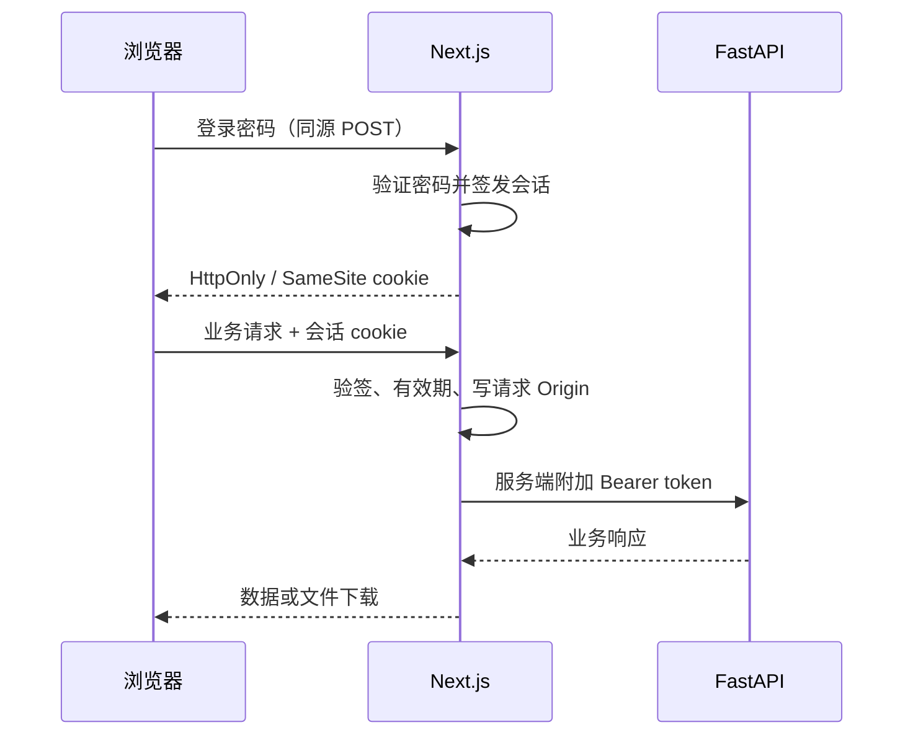

| 变量 | 设置位置 | 说明 |
| --- | --- | --- |
| `FLOW_DATA_DIR` | 本机 API / 初始化命令 | SQLite 与本地对象目录的共同数据根目录；默认 `~/.flow` |
| `DATABASE_URL` | 测试与兼容性工具 | 可选数据库覆盖；普通单机使用无需设置，默认为 `FLOW_DATA_DIR/flow.sqlite3` |
| `FLOW_API_INTERNAL_URL` | Web 服务端 | 内部 API 地址 |
| `AUTH_TOKEN` | API + Web | 相同的服务端共享 token |
| `FLOW_WEB_PASSWORD` | Web 服务端 | 单用户访问密码 |
| `FLOW_WEB_ORIGIN` | Web 服务端 | 如 `https://flow.example.com`，不含路径 |

密码与 token 不得放入 `NEXT_PUBLIC_*`。浏览器业务访问统一经同源代理，旧 `NEXT_PUBLIC_FLOW_API_URL` 配置已停用。会话有效期八小时，生产 cookie 使用 Secure；仅配置部分凭据会拒绝访问。详见[认证与会话说明](docs/operations/authentication.md)。

</details>

### 从旧版本升级

单机应用首次启动由 `make flow-init` 执行 SQLite 专用基线迁移；PostgreSQL 迁移历史保留供兼容性测试：

```bash
make flow-init
```

迁移不会为历史报告伪造冻结内容。没有 `frozen_view` 的旧快照仍可下载已经生成的产物，但不能重新渲染；需要从当前符合审批条件的数据重新冻结。数据库触发器阻止已冻结 payload 被改写。

## ✅ 开发、测试与验证

### 日常检查

```bash
make lint
make typecheck
make test-web
make contracts-check
```

修改 API schema 后执行 `make contracts`，检查生成的 OpenAPI/TypeScript 差异，再运行 `make contracts-check`。仅验证漂移时直接运行 check，不要先生成来掩盖未提交的差异。

### 分层门禁

| 命令 | 覆盖范围 | 环境与注意事项 |
| --- | --- | --- |
| `make test-web` | Vitest 组件、代理与会话测试 | 不需数据库 |
| `make test-api` | 全部 Python 测试 | 涉及迁移的集成测试使用隔离测试库；不可指向个人数据目录 |
| `make test-data-contract` | 工作簿与数据库语义往返 | 会启动开发基础设施 |
| `make test-intake-e2e` | 映射、质量、对账、发布与血缘 | 隔离 PostgreSQL 兼容性测试环境 |
| `make test-metrics-known-answers` | 指标精确已知答案 | 独立数据库 |
| `make test-analysis-invariants` | 分析政策与驱动不变量 | 独立数据库 |
| `make test-dashboard` | 页面、筛选、身份交接 | PostgreSQL + Playwright Chromium |
| `make test-investigation-e2e` | 调查与复核流程 | PostgreSQL + Playwright Chromium |
| `make test-copilot-evals` | 引用、数字、降级与审计 | 按脚本准备数据库 |
| `make test-publishing-golden` | 四格式关键值一致性 | Playwright Chromium 与领域测试环境 |
| `make test-user-closure-e2e` | 本地组合回归与用户入口冒烟 | 会启动服务；监督器仅清理本次启动的进程组，数据库仍须隔离。CI 由独立 job 覆盖前置门禁后仅运行闭环专属部分 |
| `make acceptance` | Phase 1–10 的七组组合验收 | **会清空 Compose `flow` 库的 public schema，不可用于业务库** |

需要浏览器门禁时安装仓库对应的 Chromium：

```bash
npx --yes pnpm@10.17.1 exec playwright install chromium
```

CI 定义见 [FLOW CI](.github/workflows/ci.yml)。无数据库 unit job 与需要基础设施的 integration job 已分开；本地定向验证、历史阶段验收、远端 CI 三种证据应分别阅读。最新运行请查看 [GitHub Actions](https://github.com/davyzhong/FLOW/actions)，不要把某次历史成功当作当前全量通过。

## 🤖 Built by

**FLOW 团队** — 兼管产品（战略 / 边界 / 价值门槛 / 量化验收）与工程（worktree / SHA / 门禁 / 提交纪律）的双线团队。

工程实践（v2 视角摘录，完整治理见 [`AGENTS.md`](AGENTS.md)）：

- 🏛️ **三层两模块架构**（[D053](docs/10_governance/decisions/D053--三层两模块边界与执行顺序.md)）—— 治理底座 + 共享分析底座 + 两个产品模块
- 🔐 **证据复核状态机** —— Finding → Evidence → Conclusion → 状态机批准
- ❄️ **冻结报告与发布** —— JSONB 冻结视图，导出仅读冻结内容
- 🤖 **多 Agent 协作纪律**（[HANDOFF.md](HANDOFF.md)）—— 串行集成 + 逐 Gate 验证 + commit → 自动 push
- 🧪 **六道门禁矩阵**（`make test-web` / `test-api` / `test-data-contract` / `test-intake-e2e` / `test-metrics-known-answers` / `test-analysis-invariants` / `test-dashboard` / `test-investigation-e2e` / `test-publishing-golden` / `test-user-closure-e2e`）
- 📦 **日常单机运行**：Python 3.13 + FastAPI + SQLAlchemy + SQLite + 本地文件目录 + Next.js 16 + React 19 + TypeScript。PostgreSQL、Redis、S3/MinIO、Celery 只留在兼容性测试链，不属于普通启动路径；pnpm、uv、Playwright 与 GitHub Actions 用于开发和验收。

## 💖 致谢

- [FastAPI](https://fastapi.tiangolo.com/) — 高性能 Python Web 框架
- [Next.js](https://nextjs.org/) — React 全栈框架
- [PostgreSQL](https://www.postgresql.org/) — 标准关系数据层
- [Redis](https://redis.io/) — 异步任务基础设施
- [Pydantic](https://docs.pydantic.dev/) — 数据契约与运行时校验
- [SQLAlchemy](https://www.sqlalchemy.org/) + [Alembic](https://alembic.sqlalchemy.org/) — ORM 与数据库迁移
- [openpyxl](https://openpyxl.readthedocs.io/) + [python-pptx](https://python-pptx.readthedocs.io/) — 工作簿与演示文档
- [Playwright](https://playwright.dev/) — 端到端浏览器测试
- [GitHub Actions](https://github.com/features/actions) — 持续集成
- [pnpm](https://pnpm.io/) + [uv](https://docs.astral.sh/uv/) — 依赖管理

## 🆚 同行对照（v2 视角）

> FLOW 不是通用 BI 工具，不是 LLM 包装，也不是 Agent 平台——它是面向经分专员的**可复核财务经营分析工作台**。下表说明差异：

| 维度 | FLOW | 通用 BI（Tableau / PowerBI） | 通用 LLM Chat（ChatGPT Enterprise） | Agent 平台（LangGraph 等） |
|---|---|---|---|---|
| **数据契约** | `flow.excel.v1` 十张工作表强校验 + 映射版本化 | 用户自由建模 | 不适用 | 不适用 |
| **指标定义** | 64 指标库 + 草稿/验证/激活/退役生命周期 | 计算字段 | 不适用 | 不适用 |
| **数字来源** | 确定性引擎唯一，AI 引用不重算 | 表达式 | LLM 估算 | LLM 估算 |
| **证据链** | Finding + Evidence + Conclusion 状态机 | 无 | 无 | 弱 |
| **报告冻结** | JSONB 不可变 + 字节校验 | 重导出可能改变 | 不适用 | 不适用 |
| **可复核性** | SHA-256 全链路（文件/映射/导入/分析/报告） | 无 | 无 | 弱 |
| **领域适配** | 物流 / 财务知识库内置 167 科目 + 28 CAS↔IFRS 映射 | 通用 | 通用 | 通用 |
| **离线可跑** | Ollama 离线 `DeterministicProvider` | 离线 | 在线 | 在线 |

## 📁 仓库导航

```text
FLOW/
├── apps/web/                 # Next.js 页面、组件、同源代理与浏览器测试
├── services/api/             # FastAPI、领域服务、模型、迁移和 Python 测试
├── packages/contracts/       # OpenAPI 与生成式 TypeScript 合约
├── config/                   # Intake 别名/转换、指标目录、客观分析条目
├── templates/excel/          # flow.excel.v1 机器契约
├── fixtures/                 # 标准/非标准工作簿与确定性参考数据
├── infra/                    # Compose、容器构建文件
├── scripts/                  # 生成器、演示初始化与分层验收
└── docs/
    ├── README.md                 # 全部文档导航与当前阅读路径
    ├── 00_start_here/            # 唯一入口：PROJECT_STATE / READING_ORDER / DOCUMENT_MAP
    ├── 10_governance/            # 决策索引 D001–D055 + 单项决策 + 治理规则 + legacy 豁免锁
    ├── 20_product/               # 产品定义六件套（愿景/范围/用户/能力/边界/发布）
    ├── 30_architecture/          # 架构聚合五文档（系统/数据/领域/指标/安全部署）
    ├── 40_specs/                 # SPEC_INDEX + 九个规格域
    ├── 50_plans/                 # CURRENT_ROADMAP（唯一路线图）+ 稳定工作包 + 视图
    ├── 60_delivery/              # 实施/验证/发布记录 + 生成式状态视图
    ├── 70_operations/            # 认证与部署运行手册
    ├── 80_reviews/               # 审查与无上下文接续测试
    ├── 90_archive/               # 历史计划与会话归档（do_not_execute）
    ├── architecture/             # 运行架构、领域对象与血缘（原位）
    ├── data-contract/            # Excel 数据契约（机器消费，原位）
    ├── knowledge-base/           # 静态知识库：10_sources 来源层 / 20_cards 知识卡 /
    │                             #   30_handbooks 领域手册 / 50_mappings 产品映射 +
    │                             #   不可变档案（会话/研究/原图/微信）
    └── assets/                   # README 视觉资产
        ├── cockpit-visual-direction-2026-10-18.png # 浏览器确认的 A+C 概念板（示意数据，非产品截图）
        └── screenshots/          # 当前真实页面截图与来源说明
```

| 你想了解什么 | 推荐入口 |
| --- | --- |
| 全部文档与哪份是最新 | [文档中心](docs/README.md)、[文档状态登记](docs/documentation-status.md) |
| 产品为什么这样设计 | [战略重构设计（D052–D054）](docs/superpowers/specs/2026-09-13-flow-strategic-reset-design.md)、[D055 单机单用户原型决策](docs/10_governance/decisions/D055--单机单用户验证原型.md)、[A+C 可复用视觉语言设计稿](docs/superpowers/specs/2026-10-24-flow-visual-language-system-design.md)、[固定产品原则](docs/20_product/PRODUCT_PRINCIPLES.md)、[正式 V1 规格](docs/superpowers/specs/2026-08-29-flow-v1-design.md)、[决策索引 D001–D055](docs/10_governance/DECISION_INDEX.md) |
| 当前完成到哪一步 | [项目状态](docs/00_start_here/PROJECT_STATE.md)、[当前路线图](docs/50_plans/CURRENT_ROADMAP.md) |
| 新 Agent 接续 | [Agent 起点](docs/knowledge-base/00_start_here/AGENT_START_HERE.md)、[交接指南](docs/knowledge-base/07_handoff/CONTINUATION_GUIDE.md) |
| API 方法、路径与类型 | [API 路径索引](docs/api-reference.md)、[OpenAPI](packages/contracts/openapi.json) |
| 文件如何进入标准数据层 | [Intake 说明](docs/intake/flow-v1-intake.md) |
| 数字从哪里来 | [指标口径](docs/metrics/flow-v1-metrics.md)、[领域身份](docs/architecture/flow-v1-domain-objects.md) |

## 🧭 当前进度与边界


单机原型工作包已结案：SQLite + 本地文件目录、同步处理、单一启动入口、阶段 7 冷启动/离线展示验收均已交付。当前唯一执行项是 A+C 可复用视觉语言提炼与全项目视觉统一；可移植 token、CSS、表达范式与 specimen 已建立，Web 主题、共享外壳、主要页面/图表、离线快照和报告导出映射已接入。20 路由×3 视口已完成首轮矩阵；2026-10-25 修正了 dashboard 双平台截图基线，隔离 dashboard E2E 7/7、报告渲染器定向测试 21/21 通过。逐图表、导出模板、交互与无障碍验收仍在进行，准确 SHA 的全量 CI 尚待结案。完整状态、限制与队列见 [CURRENT_ROADMAP](docs/50_plans/CURRENT_ROADMAP.md)。页面演示数据继续标识为合成数据，不冒充真实披露。

本仓库尚未提供独立的 LICENSE 文件；使用与分发授权请向项目维护者确认。贡献与协作遵循 [AGENTS.md](AGENTS.md)：先读项目状态和正式决策，保护原始档案，按风险验证，每个完整任务只提交相关文件并推送规范远端。

---

## 🗓️ Roadmap（v2 视角）

> 长期战略方向以 [D052–D054](docs/superpowers/specs/2026-09-13-flow-strategic-reset-design.md) 为准；当前原型阶段边界与执行顺序以 [D055](docs/10_governance/decisions/D055--单机单用户验证原型.md) 和 [CURRENT_ROADMAP](docs/50_plans/CURRENT_ROADMAP.md) 为准。

- [x] **Phase 1–10** — 窄切片 + Pilot + 双轮审查修复（R1–R9 / N1–N3） ✅
- [x] **P5 真实财报反向解析** — 5 家公司 / 14 份报告 / 670 科目事实 ✅
- [x] **P00–P02 基线** — 基线刷新 + 口径订正 + 主题/比较合同 ✅
- [x] **U1–U3** — 主题/比较合同 + 确定性拆解 + 同源证据与快照投影（U2 剩 2 项外部依赖登记中） ✅
- [x] **U5–U7** — 客观报告门禁 + 统一冻结 + 四问工作台 ✅
- [x] **U8** — 生产就绪收口（真实存储旅程 + HTTPS 拓扑 + 统一部署验收） ✅ completed；严格冻结门禁通过
- [x] **S01** — 战略边界 + Financial Facts Contract V2 + 安全/RBAC/审计门禁 ✅
- [x] **D055 / 7a** — 单机单用户原型、A+C 驾驶舱及离线预览已完成；详见[结案差距审查](docs/60_delivery/verification/2026-10-24--prototype-completion-gap-review-v1.md)
- [🚧] **可移植视觉语言与全项目统一** — 当前唯一执行项；用户已批准，按工作包逐项实施
- [ ] **K2** — 当前队首任务结案后恢复静态知识刷新；ObsidianWiki 保持只读，启动前核验外部知识库工作区
- [ ] **U4** — 独立全行验证与留出泛化（依赖 oracle 人工录入）⬜ 外部到料即并行
- [ ] **公开模块 C 级出口** — Go/No-Go 裁决（前置人工项不变）
- [ ] **U9–U10** — 内部试点 + V1.1 证据决策（⬜ 待授权；按 [D053](docs/10_governance/decisions/D053--三层两模块边界与执行顺序.md) 重新裁决）

## 🔒 安全

> **本仓库尚未提供独立的 SECURITY.md**（v2 适配建议新增）；漏洞披露流程占位：

- 漏洞披露流程（建议）：通过 GitHub Private Vulnerability Reporting 提交，或邮件至项目维护者。
- 治理铁律（已实现，详见 [`AGENTS.md`](AGENTS.md)）：原始档案保护、来源登记门禁、CI 强制校验、未提交证据不得批准 Finding。
- 生产部署注意事项：见 [`docs/70_operations/`](docs/70_operations/) 中的认证与部署运行手册；`AUTH_TOKEN` + `FLOW_WEB_PASSWORD` 不入 `NEXT_PUBLIC_*`；会话 cookie Secure + SameSite。

## 🤝 贡献与 Code of Conduct

- 贡献流程：见 [`AGENTS.md`](AGENTS.md)（治理铁律与工作流硬约束）。
- 提交纪律：`commit` 后立即 `git push`（无需询问；force push 是红线需先问）。
- Code of Conduct：见 [`AGENTS.md`](AGENTS.md) § 治理铁律章节；本项目计划采用 [Contributor Covenant](https://www.contributor-covenant.org/version/2/1/code_of_conduct/) v2.1（v2 适配建议新增 `CODE_OF_CONDUCT.md`）。
- 仓库协作原则（v2 摘要）：先读项目状态和正式决策 → 保护原始档案 → 按风险验证 → 每个完整任务只提交相关文件并推送规范远端。

## 📜 License

**License：未授权发布** — 详见顶部 Badge "未授权发布"。本仓库尚未提供独立的 `LICENSE` 文件；使用与分发授权请向项目维护者确认。v2 适配建议：发版前明确 LICENSE 类型（推荐内部商业项目使用 Proprietary / 项目特定 EULA；如需开源则建议 AGPLv3 以保证衍生作品同样可复核）。

---

<div align="center">

<sub>🤖 [FLOW 团队](https://github.com/davyzhong) 用 ❤️ 维护 · [⭐ Star 我们](https://github.com/davyzhong/FLOW) · [🐛 报告 Bug](https://github.com/davyzhong/FLOW/issues)</sub>
<br>
<sub>📜 本 README 的截图、数据、架构和进度说明均应标明事实状态与来源。</sub>
<br>
<sub>📸 截图自动化配置见 <a href=".github/workflows/screenshot.yml">GitHub Actions 工作流</a>；该采集工作流目前按路线图暂停，恢复条件见 <a href="docs/50_plans/CURRENT_ROADMAP.md">CURRENT_ROADMAP</a>。</sub>

</div>
