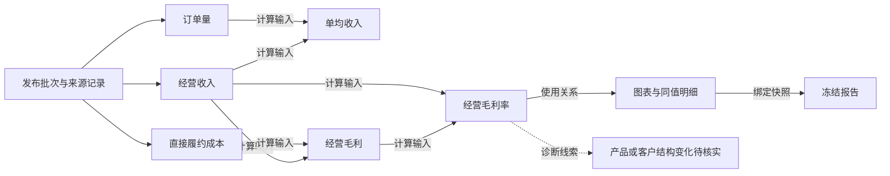

# 经营指标库与指标关系体系建设目标

## 用户补充目标

2026-10-25 用户要求吸收《经营驾驶舱分析指标库》，将“从指标到指标体系的建立”纳入 FLOW 目标。本目标细化既有专业治理底座，不重开已结案的单机架构，不新建另一套指标事实源。来源评估见[20 图核读与项目映射](../60_delivery/verification/2026-10-25--business-metric-library-reference-review-v1.md)。

FLOW 应提供一个**可查询、可解释、可维护、可观测、可实际使用的经营指标体系**：从一个指标出发，能理解它回答什么问题、如何计算、依赖什么输入、如何分层查看、能与谁比较、用于哪些图表和报告，以及为什么当前不可计算。修改规则后可查看影响范围，历史报告仍绑定原定义版本。

这是目标态声明，不代表下列内容都已实现。当前实际能力只按[能力地图](CAPABILITY_MAP.md)、[审查记录](../60_delivery/verification/2026-10-25--business-metric-library-reference-review-v1.md)与[唯一路线图](../50_plans/CURRENT_ROADMAP.md)判定。

## 体系由六部分构成

| 部分 | 产品目标 | 当前复用基础 |
|---|---|---|
| 主题目录 | 围绕增长、盈利、成本费用、资金、应收、客户、订单、产品、履约效率、人效、预算、风险组织指标；按有数据/待补数据区分 | 指标库通用/物流集合、主题页、现有业务字典 |
| 标准指标卡 | 展示身份、定义、公式、口径、单位、期间、维度、输入、来源、版本、比较和可用性 | v1.1 字典、运行定义、指标治理和覆盖区 |
| 指标关系 | 区分计算依赖、数学分解、维度汇总、比较关系、诊断线索、数据血缘和页面使用关系 | 依赖持久化、公式 AST、React Flow 依赖图、快照 trace |
| 分层分析 | 企业总览→业务线→区域→项目/客户/产品，维度存在且口径允许时才下探 | 已有组织/区域/客户/物流产品维度及查询深链 |
| 页面与报告消费 | 指标卡、趋势、结构、差异、关系图、支持表、调查和冻结报告共用定义与快照 | ECharts、图表构建器、字典/来源路由、报告冻结 |
| 建立与维护流程 | 来源候选→复用/映射→口径核验→数据覆盖→关系校验→版本发布→页面验证→变更影响/监测 | 现有治理版本、执行绑定、影响沙箱、追加审计；单机身份操作 |

企业/业务/区域/项目是业务观察层级，不要求建立四层服务、四套数据库或多角色审批平台。项目维度或某类输入尚不存在时，保留定义与缺失原因，不生成虚假层级或数据。

## 指标卡必须表达的信息

- **身份与用途**：集合/口径身份、metric_code、定义版本、中文名称/别名、所属主题、回答的经营问题、适用对象；跨集合的同码不直接合并。
- **计算与语义**：既有公式/AST 或执行绑定、输入和引用版本、单位/精度、期间流量或时点余额、期初期末/平均口径、允许的聚合和维度；不对比率求和或直接平均。
- **比较与解释**：同比/环比窗口、同口径目标与预算版本、增长率与百分点区分、零/负基数处理、方向和适用条件；不把下降一律当作改善。
- **来源与状态**：公开披露/确定性派生/合成分配/情景分型，源记录或报表行定位，当前数据覆盖、缺失原因、最近计算/发布状态；定义存在不等于当前有值。
- **治理与使用**：来源依据、业务责任角色（不等于新增账户权限）、阈值适用范围/依据/版本、上下游与使用页面、变更记录、影响报告/快照的范围。

元数据尽量引用现有定义和运行对象，页面可索引/缓存派生结果；不得复制公式或数值形成第二事实源。正式修改走现有治理和影响评审；本地单用户仍保留版本和审计。

## 关系类型与边界

| 关系 | 含义及例子 | 必须满足的限制 |
|---|---|---|
| 计算依赖 | 单均收入读取收入、订单量；毛利率读取毛利、收入 | 指向确切定义/执行版本，依赖闭合且无计算环；缺输入显式 unavailable |
| 数学分解 | ROE 与净利率、总资产周转率、权益乘数；CCC 与 DSO/DIO/DPO | 同期间/范围/币种/平均余额/天数基准，有可复算恒等式；不能仅凭图形连线认定成立 |
| 维度汇总 | 可加和的区域收入归入企业收入 | 维度层级有效、集合不重叠、抵销/币种/范围一致；比率从分子分母重算 |
| 比较关系 | 实际对预算、当前对上年同期/上期 | 同口径、版本、时间窗；基数为零或负数时按既有比较政策解释，不照抄通用达成率 |
| 诊断线索 | 收入/毛利结构变化关联客户、产品、价格、件量 | 仅是调查方向或相关性，不是因果证明，不自动生成经营原因或建议 |
| 数据血缘 | 指标结果→输入值→发布批次/财报行→原件 | 绑定快照与源身份，外部正文/图片只是研究证据，不是企业运行事实 |
| 使用与影响 | 指标定义→驾驶舱图表/分析/冻结报告 | 新版本不回写历史快照；展示变更影响范围，缺链接时说明 |

现有字典 `relations` 已混有数学关系与定性诊断条目，后续先分类核验再呈现；不得把整段文字当可执行公式或将风险线索画成已证实因果。

以下是**物流经营口径的关系表达目标**，不是新增公式或当前图谱功能的完成声明；实线为既有计算/使用关系，虚线为需业务证据的诊断线索：

## 首批关系链与主题覆盖

首批以已有输入和页面验证四条关系链：

1. **增长与盈利**：收入、订单量、单均收入、直接成本、毛利/毛利率，链接既有经营利润桥与产品/区域结构；营业利润仍采用既有正式口径，不简化为毛利减全部费用。
2. **资金与周转**：应收余额、对应收入窗、DSO/DIO/DPO/CCC、经营现金流与来源；通用 360 天、物流 T12×365 天及财报年度天数是不同口径，不能静默互换。
3. **预算与执行**：同期间/维度的实际、明确版本预算、金额差异、差异率/达成率；缺预算或基数不适用时保留原因。
4. **杜邦与资本**：冻结 ROE 与三因子、平均资产/权益、利润/收入及报表来源；缺期初值时不借期末值冒算。

客户留存/NPS、销售线索转化、HR/FTE、人效、供应商质量、制造产能、项目工期等可作为候选目录；只有补齐相应数据、定义与用户场景后才能实现。首版不因文章有十二类目录就新建十二个页面，也不将文章的“20–30 个一级指标”当成完成数量门槛。

## 从来源到正式指标的建立方式

先查重当前字典、运行定义和图谱，把“同名同义复用”“同名不同口径”“新定义待数据”“不适用物流”分开；然后为选中指标写清计算/时间/范围/单位/来源和数据缺口。计算边从现有 AST/依赖记录生成，维度/比较/诊断边独立标型。校验无环、量纲、聚合、预算版本、数值与原表后，沿用现有治理版本及执行绑定发布，在既有页面和冻结报告验证消费。没有通过核验的内容保留研究候选，不发布为正式公式或预警规则。

本次不改数据库 schema、计算 YAML、运行时、阈值或 CURRENT_RELEASE；后续如确需扩展合同/存储，另按已有影响评审和授权红线执行。

## 可验收的目标

- 四条首批链都能从关键值到定义、输入、来源及使用页面；关系边类型明确，诊断线索不冒充计算或因果。
- 每个正式候选具备上述元数据；数据受限项有具体缺字段/期间/口径原因，不以零值掩盖。
- 图谱、指标详情、支持表与冻结报告引用同一版本；变更可定位受影响结果，旧报告可重现。
- 不重复造已有指标、React Flow 图谱、ECharts、公式引擎或治理状态；单机 SQLite/本地目录架构保持简洁。
- 新资料纳入既有知识刷新/战略重基线的来源评审，实施顺序只在 CURRENT_ROADMAP；不重开已结案 7a，不抢占正在执行的视觉事项。
