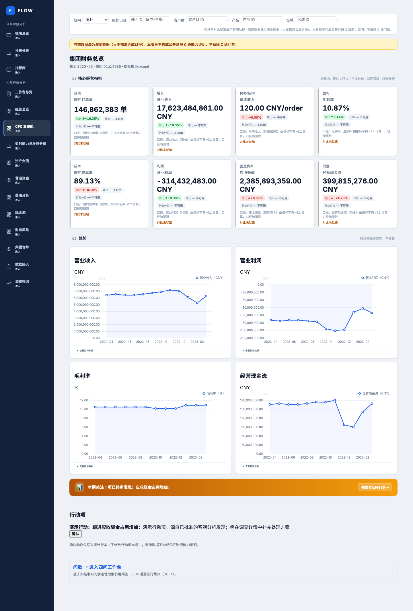
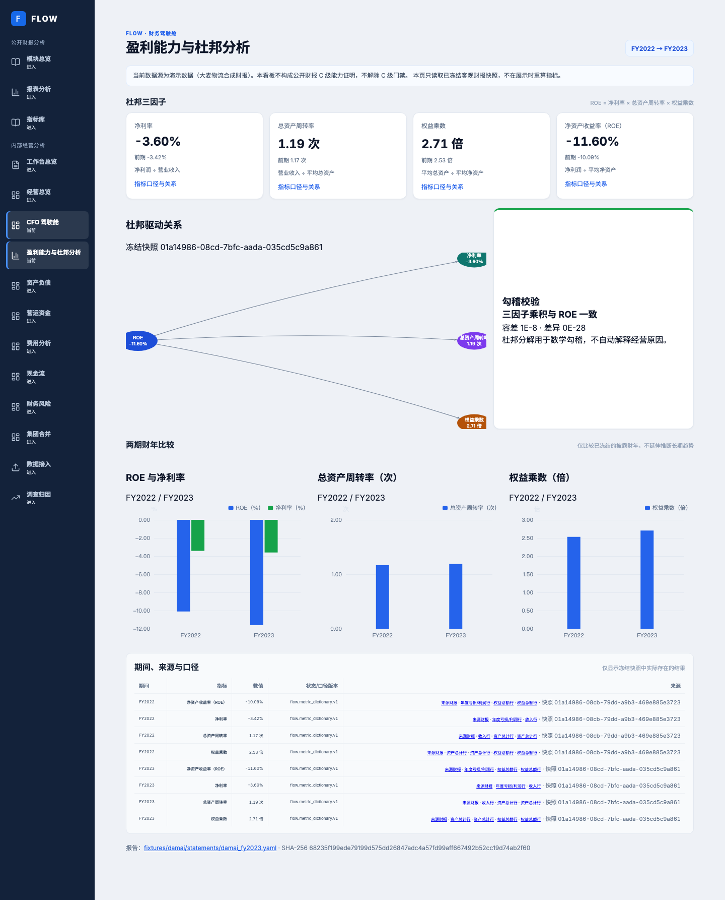
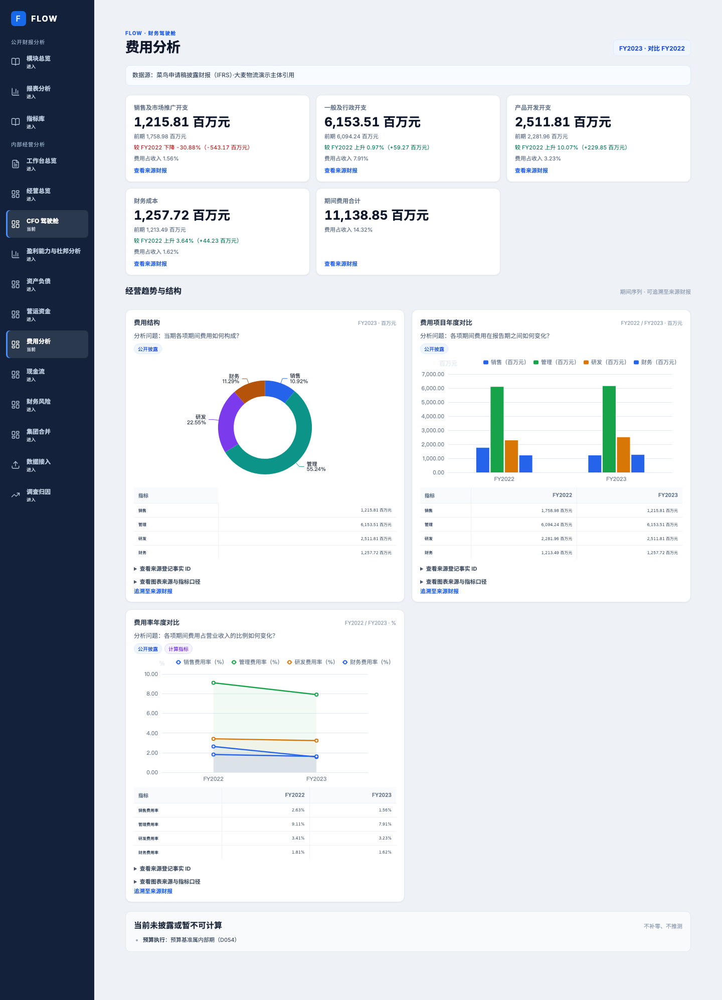
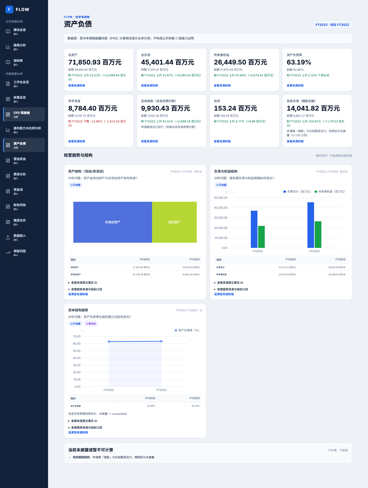
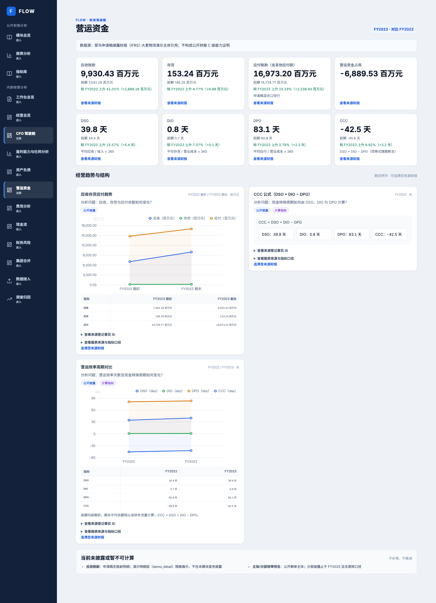
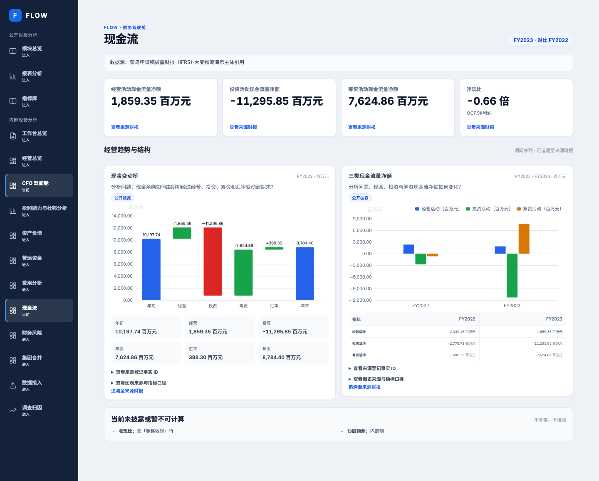
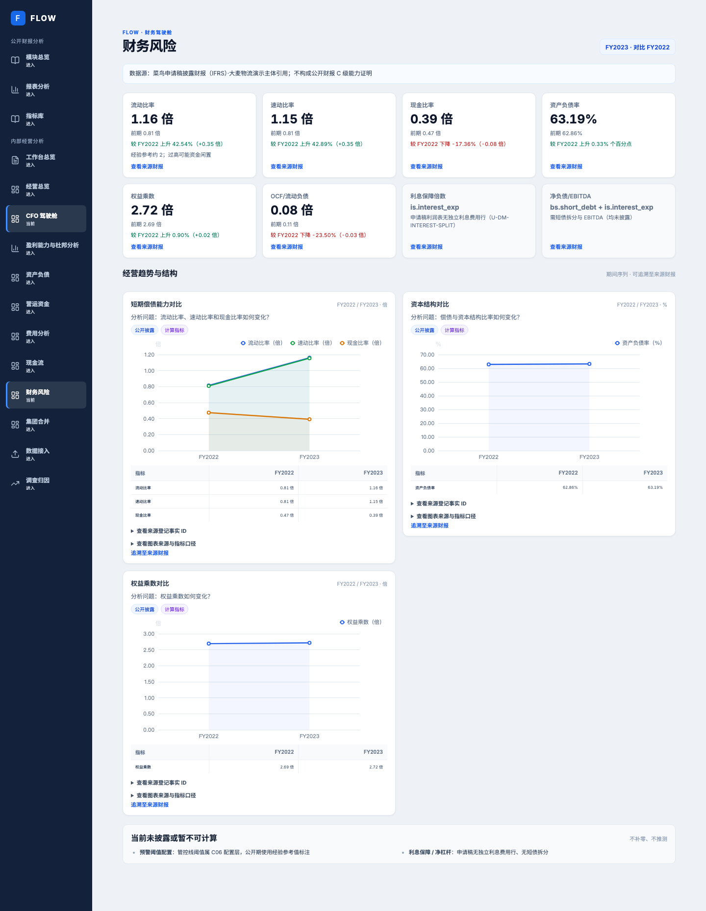
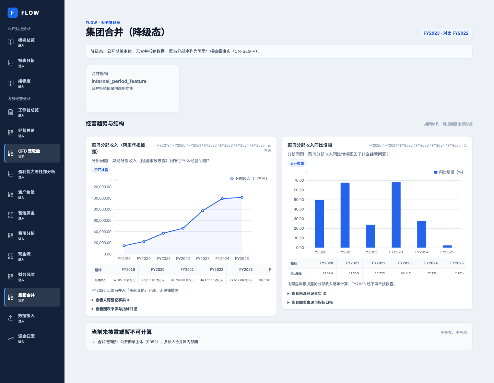
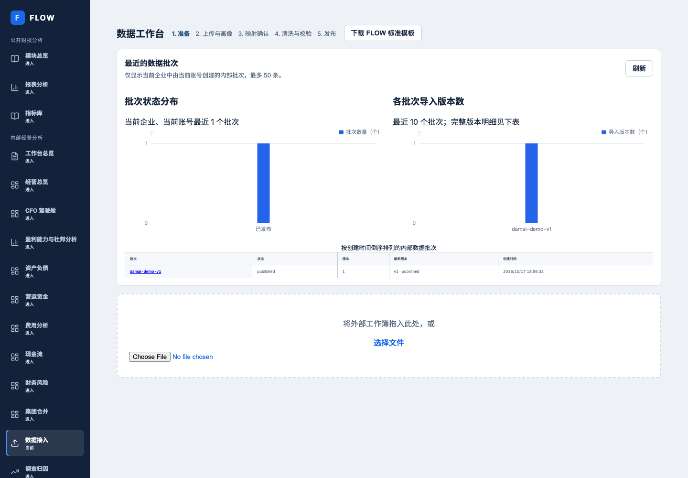

# CFO 驾驶舱全视图图表浏览器核验

## 结果

在当前工作分支的生产构建页面和一次性隔离大麦账套中，逐页打开八个 CFO 驾驶舱页面及 `/data`。九页均加载完成，无浏览器页面异常；总览显示 4 个 ECharts 画布，其余页面各至少 2 个，合计 25 个。页面可见年度/月度期间、单位、分析问题、财务指标、同期数据表或来源追踪入口。大麦主体与月度/组织级分配明确属于 synthetic 演示数据，不应解释为菜鸟公开的逐月、逐笔经营事实。

| 页面 | 浏览器实测 ECharts 画布 | KPI 卡 | 图表数据表 | 页面状态 |
|---|---:|---:|---:|---|
| `/cockpit` 总览 | 4 | 8 项总览指标 | 趋势详情折叠区 | 就绪；4 张趋势图有点 |
| `/cockpit/profitability` 盈利能力与杜邦分析 | 4（另有杜邦关系图） | 4 项杜邦因子/结果 | 1 | 就绪；勾稽通过 |
| `/cockpit/expenses` 费用分析 | 3 | 5 | 3 | 就绪 |
| `/cockpit/balance-sheet` 资产负债 | 3 | 8 | 3 | 就绪 |
| `/cockpit/working-capital` 营运资金 | 2 | 8 | 2 | 就绪 |
| `/cockpit/cashflow` 现金流 | 2 | 4 | 1 | 就绪；现金桥和三类现金流对比 |
| `/cockpit/risk` 财务风险 | 3 | 8 | 3 | 就绪；未披露风险项明确缺省 |
| `/cockpit/consolidation` 集团合并 | 2 | 1 | 2 | 降级态；公开分部收入可视化，抵销数据未披露并明确说明 |
| `/data` 数据工作台 | 2 | — | 批次记录 | 就绪 |

本次以 1440×1000 桌面视口逐页打开，等待页面请求静止后核查 DOM、ECharts canvas、状态、表格及浏览器错误并保存长截图。九页均无页面级 JavaScript 错误。表中画布数量来自实际 DOM；盈利能力页还包括不使用 ECharts canvas 的杜邦关系图。随后新增 Playwright 自动化用例，对九路由分别在 1440px 和 390px 视口执行图表画布与横向溢出断言，18 个路由×视口组合全部通过。

再以 390×844 窄屏逐页打开全部九页：九页均无横向溢出（`scrollWidth` 与视口宽度同为 390px），页面就绪、图表均有画布且无 JavaScript 错误；对应窄屏截图位于 `assets/cockpit-visual-completion-2026-10-17/mobile/`。首次实测发现总览图表网格仍强制 420px 最小宽度，已增加窄屏单列规则并在生产构建中重新核验。

## 隔离输入与页面截图

- 本地代码基线：图表契约提交 `df5c338bc5c1d7330be2391189cdfb828099a962` 加本轮页面联动和展示变更；浏览器使用当前工作区生产 standalone 构建，前端端口 `3461`，后端端口 `8000`。浏览器身份 `flow-dev-bp` 与隔离批次创建者匹配，RoleBinding 仅播种到该一次性测试数据库。
- 一次性隔离数据库：`flow_cockpit_visual_20261017a`，PostgreSQL 端口 `15432`；Redis `16379`、MinIO `19000`。未连接常驻业务库。
- 大麦发行清单 SHA-256：`6f3ef9176aaa02009c36080621d40ff6212ab1189c6e2c0695f5ea5f1b688fed`；演示批次 `01a14981-a17c-726e-93b7-732e2672c718`；导入版本 `01a14981-a192-7016-9425-4476c2a206e6`。
- FY2022/FY2023 来源报告 SHA-256：`b58d179c2584354134321efaa7e289d6f923b23bb12c74e4f1d62c5d95869661` / `68235f199ede79199d575dd26847adc4a57fd99aff667492b52cc19d74ab2f60`。
- 截图为完整页面实测图，保存在本目录 `assets/cockpit-visual-completion-2026-10-17/`。
- 交互实测：从资产负债图表点击“追溯至来源财报”，浏览器进入对应 FY2023 财报并定位到 `合并资产负债表 / 流动资产合计` 行；定位后目标行位于可视区（视口 top 约 485px），没有页面异常。

### CFO 总览

### 盈利能力与杜邦分析

### 费用分析

### 资产负债

### 营运资金

### 现金流

### 财务风险

### 集团合并

### 数据工作台

## 验收范围与限制

- 总览四项指定 CFO 指标和演示行动项可见；四张趋势图有 12 期数据点，API 当前来源快照为真实隔离账套。
- 图表来源信息展示报告/来源事实登记、指标代码、指标快照；已提供报告追溯链接及图表旁的数值表。
- 公开数据未披露的合并抵销、部分风险指标等继续显示不可用原因，不用虚构值填充。
- 本轮 Playwright 全视图测试覆盖桌面/窄屏非空 canvas 像素、图表与 API/数据表逐点相等、趋势点、杜邦比较图、模块事实标签/来源块，以及 CFO 指标和行动项；六个模块全部图表的 series、waterfall steps、formula_card 的 DSO/DIO/DPO/CCC 均与 API 逐值对账；盈利能力页的所有期间指标行逐行核对期间、指标、格式化数值、定义版本/缺口原因和报告链接。另使用键盘展开来源披露、点击资产负债图表的财报源行并验证目标进入视口、确认行动项并校验审计状态，并模拟模块 403 态。前端单测覆盖来源登记、图表 empty_reason 和异步 hash 定位。行动确认只作用于一次性隔离库，生成审计事件。独立复核已完成且未发现剩余 P1/P2；最终代码 SHA CI 仍待结案，因此本报告保持 active。
- 本地浏览器测试首次失败的原因是预览进程使用了不同的隔离库身份及旧 standalone 服务；修正为报告对应的隔离数据库 `flow_cockpit_visual_20261017a` 与批次账号后，同一 Playwright 用例 18/18 组合通过。未修改常驻开发库。
- 阶段 3 提交 `df5c338bc5c1d7330be2391189cdfb828099a962` 的 GitHub CI run `39038535194` 在本报告修订时仍处于 `in_progress`，已失败的 `static-web` 与依赖构建的 `smoke` 报出测试 fixture 未补齐新图表契约必填字段；模块边界 E2E 同提交失败且需待该 run 完成后读取完整日志。当前工作区已补齐 fixture 并通过全仓 lint/typecheck、契约检查和本地浏览器验收；本轮代码提交后仍需以最终准确 SHA 核验 GitHub CI。
