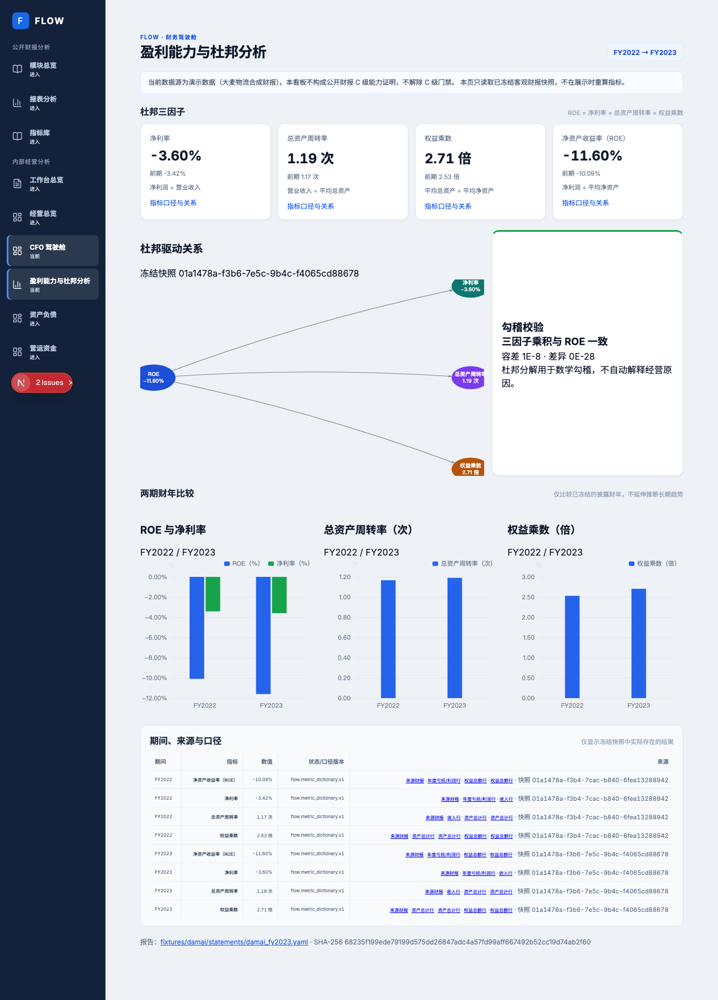

# CFO 驾驶舱盈利能力页面浏览器验收

## 结果

在一次性隔离的大麦演示栈中打开 `/cockpit/profitability`，杜邦指标卡、杜邦关系图、三张两期比较图、勾稽状态和来源财报行链接均正常渲染。全套大麦浏览器旅程 16/16 通过；其中本页测试会保存此文档所附截图。页面展示主体明确标注为 synthetic 演示企业，财报来源为公开披露的菜鸟数据；截图数值不应解释为真实大麦企业的经营结果。

## 可复核输入

- 运行命令：`bash scripts/test_damai_demo_e2e.sh`
- 隔离环境：Compose 项目 `damai-demo-iso`；Postgres/Redis/MinIO 使用该脚本专用端口和卷，脚本退出时清理隔离容器与卷；未连接常驻数据库。
- 演示发行清单 SHA-256：`c73848806010685c7b5698b5f65228db2e67e01bf38a788eda6911bbcb6ce11e`
- 页面数据批次：`01a14786-a984-7b74-a6ab-e97caf35fd2c`；导入版本：`01a14786-a99a-7259-8efe-1bc0fb679d1f`。
- 财报：FY2022 SHA-256 `b58d179c2584354134321efaa7e289d6f923b23bb12c74e4f1d62c5d95869661`；FY2023 SHA-256 `68235f199ede79199d575dd26847adc4a57fd99aff667492b52cc19d74ab2f60`。
- 发行版核验：19/19；可见性矩阵：162 路由、152 个 HTTP 200、10 个预期拒绝、0 失败；Playwright 全旅程：16/16。
- 截图 SHA-256：`e66dc5e1856e0ad71c56aaa1b552eb393cecb788a6674eb74f279c4c44c4eb1e`。
- 代码提交：功能实现 `5817efcf10bf1ce68057a626af3491b508c7513f`；重复 seed 幂等修复 `08aa4cd02247f995bc990d92c8f34f5a1829afa1`。
- 幂等性回归验收：盈利载荷在归一化行 UUID 重建后保持不变；冻结工作流二次 seed 计数零增长。定向后端测试 10 项通过，Ruff 与 mypy 通过。
- GitHub CI：run `38996089002` 对应修复 SHA `08aa4cd02247f995bc990d92c8f34f5a1829afa1`，18/18 jobs success。

## 页面检查

- 显示 FY2022 → FY2023 的四项指标，并明确列出公式、期间、快照和口径版本。
- 杜邦关系可视化以及 ROE/净利率、资产周转率（次）、权益乘数（倍）两期比较均使用现存 ECharts。
- 图表百分比输入由 ratio 转为百分数一次；周转率与权益乘数各自按“次”“倍”显示。
- 指标表中来源事实链接至对应财报行锚，并保留页码提示；截图显示合成演示数据提示。
- 如来源行、快照或平均余额缺失，页面按 unavailable 显示，不推测、不补零。
