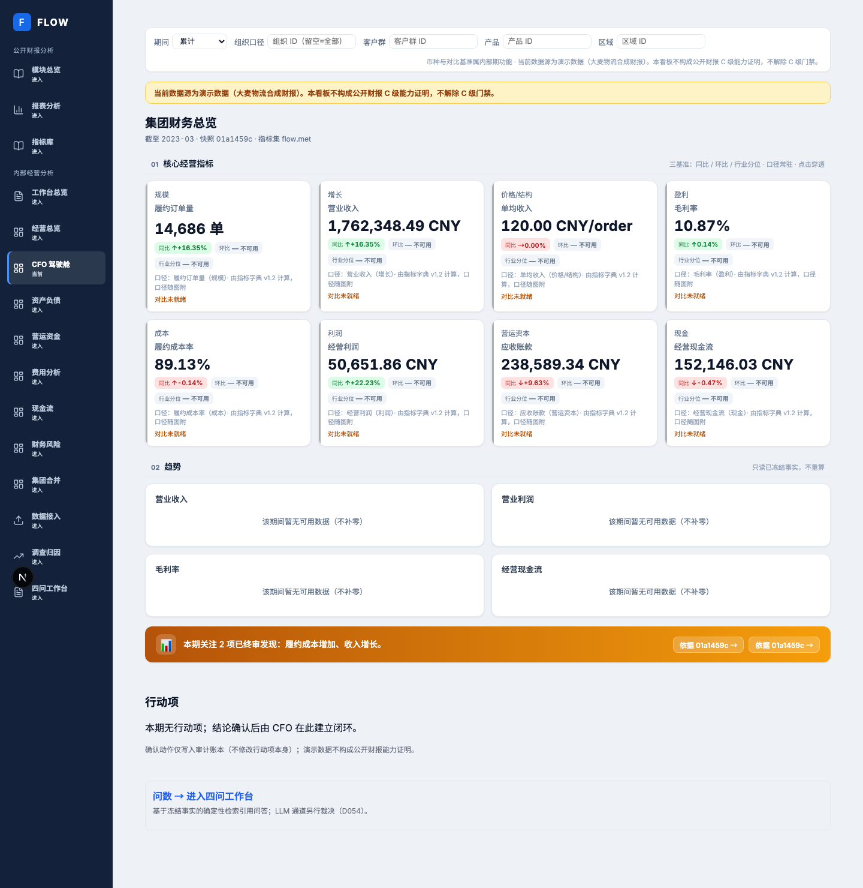
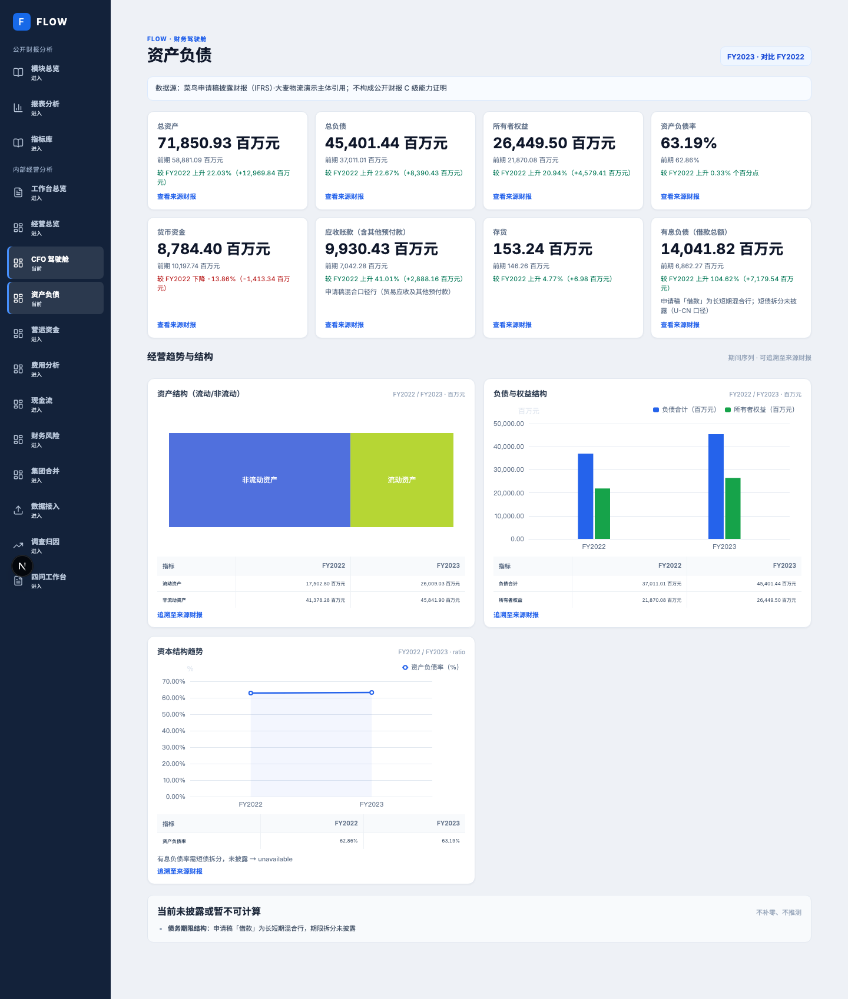
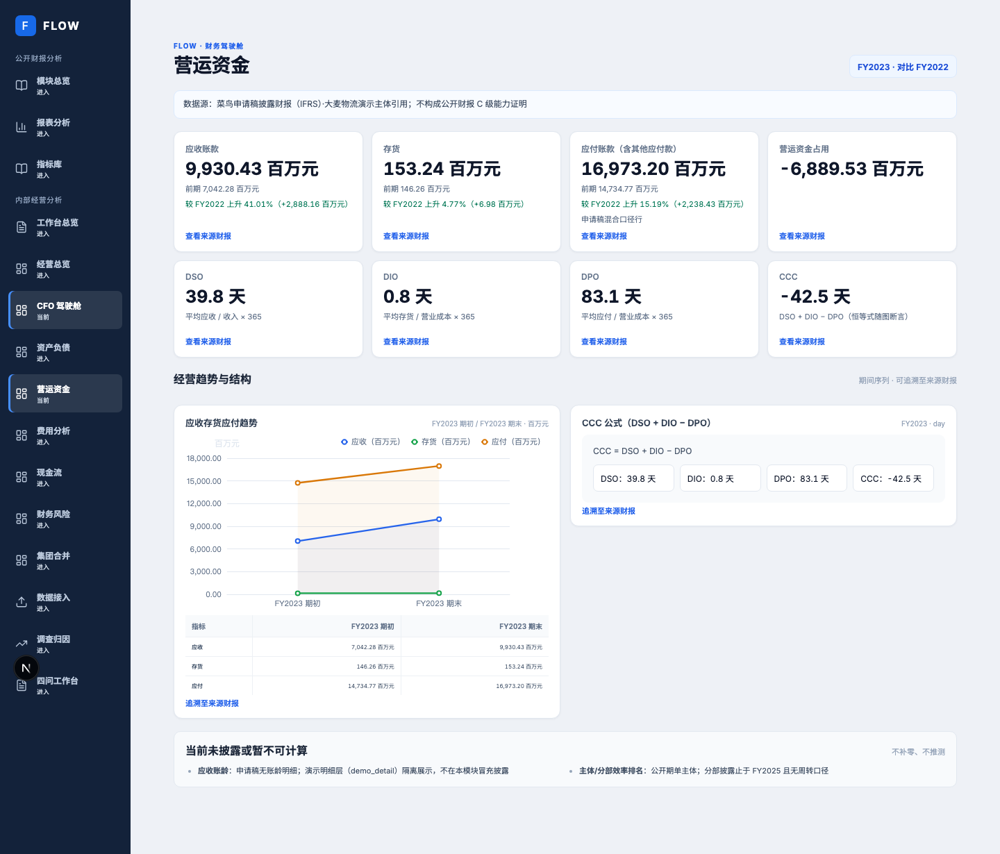
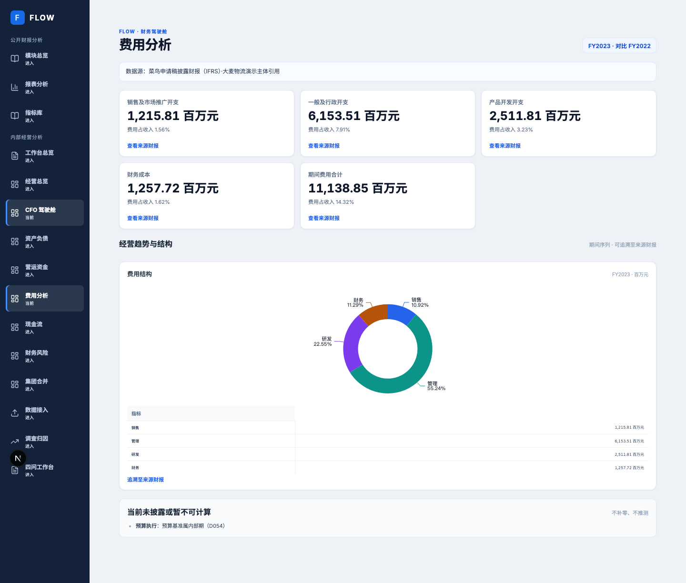
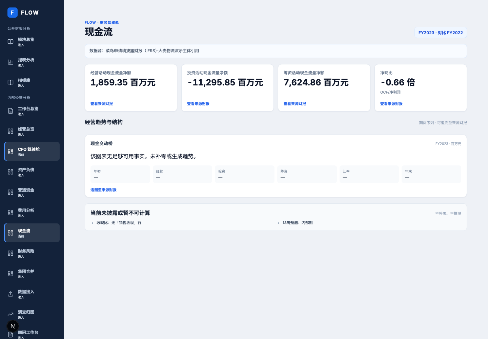
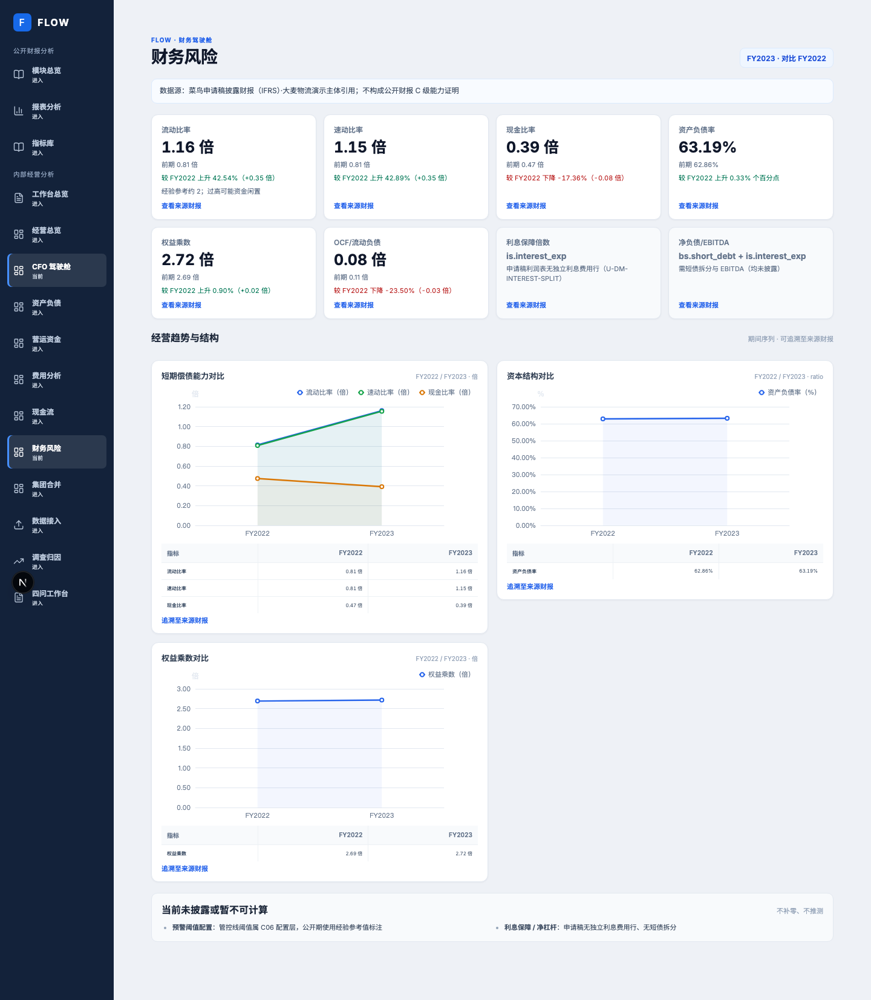
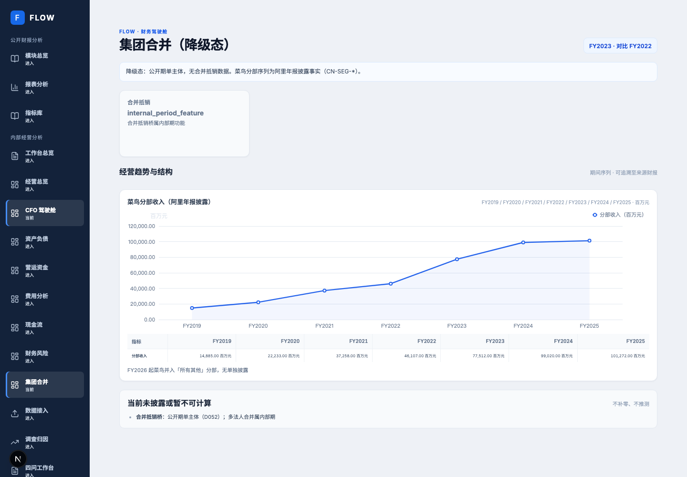

# FLOW 项目进展、驾驶舱完成度与后续决策报告

> 本报告核对截至 2026-10-17 的已推送驾驶舱分支 `codex/cockpit-visual-completion`，基线代码 SHA 为 `d0d24e27ab2e35040570521316cbe0fe572d139a`。驾驶舱截图来自隔离演示账套和真实页面浏览器验收，不代表生产环境，也不代表“大麦物流”真实企业数据。项目唯一任务队列仍以[当前路线图](../../50_plans/CURRENT_ROADMAP.md)为准。

## 结论

项目没有偏离已确认的方向：公开披露财务事实、完整来源链、可解释指标和可验证界面仍是当前基础；未来再进入企业内部月度经营分析。驾驶舱已经从“有路由、有 KPI，但趋势区域空白/图形不足”推进到 8 个可运行页面，并有实际图表、前期比较、数据表、指标定义及来源追溯。最近增加了盈利能力与杜邦分析页面。

但它还没有达到最初参考资料所示的完整 CFO/经营管理闭环。现有截图和测试证明了特定披露数据下的页面渲染及交互，不证明全部约 51 个原型图表都已成为可用图形；“51 图”是覆盖映射，包含 KPI 卡、数据表和明确 unavailable，不是 51 张已完成的图。预算/目标比较、滚动预测、情景分析、业务维度归因、现金预测、经营结论叙事和整改收益验证仍明显受公开数据缺项或产品能力缺口限制。

## 项目当前执行状态

路线图记录的唯一队列为 **13 项**：已完成 7 项，实际执行中 0 项，队首待启动 1 项，排队 3 项，暂停 1 项，外部材料受限 1 项。两项驾驶舱交付（视觉与数值格式、盈利能力与杜邦）均已完成并关闭。当前唯一队首是知识刷新 K2 的实际时间门禁；不应把本报告中的建议误读为新建的并行任务队列。

在主工作区 `/Users/qiming/workspace/FLOW` 还观察到 4 个驾驶舱代码文件存在未提交并发修改。它们未包含在本报告依据的推送分支，也未在本轮验证，故不能算作已验收成果。当前报告和已有截图基于专用分支的最新提交；该分支已与 `origin/codex/cockpit-visual-completion` 同步。该交付分支尚未合入 `main`，因此“分支已交付/CI 通过”和“main 已具备”是两个不同状态。

## 已有页面、数据与图形

### CFO 驾驶舱页面矩阵

| 页面 | 可见数据与图表 | 完成情况与边界 |
|---|---|---|
| 总览 `/cockpit` | 冻结指标卡、前期对比、收入/利润/现金流趋势图区域、经营单元矩阵、风险与行动入口 | 页面结构和数据卡已验证；当前隔离截图中四个趋势图都显示“该期间暂无可用数据”，因此没有实际曲线。预算对比也不能普遍提供。 |
| 利润增长（当前复用总览 KPI 区域） | 营收、毛利、利润相关 KPI 与变化对比 | 数据同源复用；没有原参考里的独立利润增长分析页，也缺少产品/客户/价格/销量等驱动因素分解。 |
| 盈利能力 `/cockpit/profitability` | 杜邦关系图、ROE/净利率柱状对比、资产周转率和权益乘数两期图、指标表及来源行深链 | 实际图表已渲染，隔离浏览器旅程 16/16 通过；需冻结快照和平均余额，输入缺少时明确 unavailable。 |
| 费用 `/cockpit/expenses` | 费用 KPI、四项费用结构环图、数据表及披露来源 | 当前截图确认环图与数据表可见；未见期间趋势曲线。预算执行、责任部门和内部费用明细无法从公开财报获得。 |
| 资产负债 `/cockpit/balance-sheet` | 流动/非流动资产结构图、负债/权益柱状对比、资产负债率两期趋势线、偿债比率卡 | 三类图形和数据有截图；债务期限、带息债务等披露不足，趋势只有两个年度点，不构成月度连续趋势。 |
| 营运资金 `/cockpit/working-capital` | 应收、存货、应付两期折线，CCC 公式分解卡及对比数据表 | 两期曲线已渲染；账龄、客户/供应商分布与同业排名缺数据，两点之间不代表连续走势。 |
| 现金流 `/cockpit/cashflow` | 经营/投资/筹资现金流 KPI 与现金变动桥区域 | 当前截图中的现金变动桥没有足够事实，明确显示无可用数据；没有实际趋势曲线。销售收现比和 13 周现金预测也不可用。 |
| 财务风险 `/cockpit/risk` | 流动/速动/现金比率两期多线图、资产负债率趋势、权益乘数对比；利息保障/净杠杆卡 | 比率图和两期数据有截图，曲线只有 FY2022/FY2023 两点；利息保障倍数、净杠杆、债务期限缺必要拆分依据。 |
| 集团合并 `/cockpit/consolidation` | 菜鸟公开分部收入 FY2019–FY2025 七期折线与数据表 | 七年公开披露序列曲线已渲染；主体状态为合并降级，内部抵销桥和多主体对比仍不可用。 |
| 数据中心 `/data` | 数据批次、导入校验、来源/清单等现有数据管理入口 | 复用系统页面，满足数据链路核查；不是驾驶舱第十个独立财务分析页。 |

### 页面截图

以下 8 张图来自 `2026-10-17` 隔离演示截图集；截图中的主体是合成“大麦物流”，底层财务披露样本来自菜鸟公开资料。

#### CFO 总览

#### 盈利能力与杜邦分析

#### 资产负债

#### 营运资金

#### 费用分析

#### 现金流

#### 财务风险

#### 集团合并

### 当前图表覆盖判断

逐张查看当前截图后，已实际渲染的图形包括：集团合并七年收入折线、资产负债结构图/两期柱图/两期比率线、营运资金两期三指标折线、费用结构环图、风险比率两期曲线、杜邦关系图及三组比较柱图。**总览趋势区和现金流变动桥在当前验收截图中没有可绘制数据**；此前在代码映射层有图表位，不等于页面已显示曲线。资产负债、营运资金、风险及盈利能力的大多数比较只有两个年度观测点，只能说是期间对比，不能称为连续趋势。图表旁配有同口径数据表、对比指标和来源追溯。底层复用 ECharts 6.1.0 和现有十类构建器。

此前所谓“51 图”映射约包含 10 个领域的 KPI、数据表、可视化或 unavailable 项。它不能被解读为 51 种已经逐图验收的图表。图形已经比 10 月 16 日基线显著补足，但只有关键页面的截图和浏览器断言构成视觉证据；缺失数据被诚实标注的项目，也不代表对应功能已由真实数据完成。

## 与最初参考资料的对比

首批核心资料集中在[研究资料总览](../../knowledge-base/02_research/original/00_研究资料总览.md)列出的四份产品/报告样本：集团财务总监驾驶舱、生产运营分析报告、财务总监工作总结、总经理经营决策驾驶舱。外部材料均作为设计参照，不把其中的示例企业数字当成 FLOW 事实数据。

| 参考能力 | 参考资料的预期形态 | FLOW 当前证据 | 评估 |
|---|---|---|---|
| CFO 十模块导航与统一筛选 | 总览、利润、盈利、费用、资产负债、营运资金、现金流、风险、合并、数据中心；期间/组织/币种/累计筛选 | 8 个驾驶舱路由 + 复用 `/data`，利润增长复用总览 KPI；页面和导航已连通 | **结构基本覆盖，页面粒度未完全对齐**；独立利润增长页、更多筛选维度仍不足。 |
| KPI 对比和趋势 | 本期值、同比、预算；月度柱线趋势和持续比较 | KPI、前期对比和真实可用的时间序列图已实现；缺同比/预算事实时不推导 | **已具备基础，基准覆盖不足**；公开财报两财年不能替代完整月度同比、预算与目标序列。 |
| 结构与经营单元分析 | 组织矩阵、分部对比、利润率排名、收入贡献 | 有公开分部序列、结构/偿债/营运资金可视化 | **部分具备**；公开单主体不能支持虚构经营单元排名，不能等价于参考资料中的多主体经营视图。 |
| 差异分解/归因 | 目标利润、收入/成本/费用/税费差异的瀑布桥及驱动因子 | 已有现金流变动桥、杜邦关系拆解；缺预算/实际差额和业务因子数据 | **方法局部具备，核心经营归因未完成**。杜邦解释资本回报构成，不能替代利润差异瀑布。 |
| 现金管理与预测 | 经营现金流趋势、现金余额瀑布、13 周滚动预测、安全线 | 经营/投资/筹资披露净额可见；现金变动桥在截图中为空态 | **历史分类事实具备，图表与预测未完成**；形成瀑布桥仍需现金期初/期末及可对账变化行，未来预测还需要周粒度流入流出台账。 |
| 风险、行动、验证闭环 | 风险金额、责任人、截止日、措施状态、整改前后收益验证 | 风险页和行动项能力存在，指标可追至来源；公开演示不具备真实责任人和处理收益 | **框架部分完成，真实经营闭环未验证**；演示组织数据只用于隔离验证。 |
| 经营分析型/述职型报告 | 18 页经营分析：结论→归因→行动；16 页述职：税务/内控/团队/计划/决策 | 报告中心、调查、四问、问数与导入旅程在 E2E 中覆盖 | **平台入口存在，报告叙事与成品质量未达参考样例**；本次工作没有验证完整自动生成的 PPT/报告成品。 |
| 数据中心与指标治理 | 字段映射、勾稽、批次质量；指标公式、阈值、版本、血缘、审批 | 325 条来源事实登记、来源锚、指标目录/快照、账套验证及数据批次能力已有 | **客观数据底座进展较强**；持续刷新、审批/变更影响的完整体验仍依路线图建设。 |

最初参考中最显著的差距，不是“再多画几张图”这么简单，而是参考资料假设预算、目标、组织单元、客户/产品、账龄和预测等内部数据已存在。当前项目以公开披露数据做可信底座，因此应区分**可由公开资料验收的客观图表**与**必须等内部数据接入才能成立的管理分析**。不能用模拟责任人或推算预算值把后者包装为已完成。

## 竞品调研与复用判断

项目已沉淀 FineBI、SAP Analytics Cloud、Looker、观远、永洪、积木报表等竞品资料和五维矩阵。其共同验证的成熟做法包括：统一语义指标、筛选联动、逐层下钻、结论与行动闭环、图表钻取和报告/仪表盘分形态。FLOW 当前已采用 ECharts 作为成熟图表渲染库，继续自研指标计算、来源追溯和财务口径的业务层；图表交互增强应先评估 ECharts 现有能力和当前构建器，不另造一套绘图引擎。

对现阶段的具体含义：积木报表适合复杂固定报表/套打和嵌入式报表，不提供 FLOW 所需的统一财务指标语义层；其授权条款需要法务核验，不能仅因开源标签直接引入。通用 BI 工具可作为未来自助分析或探索的参考，但不应取代以冻结指标、来源事实和权限审计为中心的 CFO 报告事实源。详细竞品结论见[竞品矩阵索引](../../knowledge-base/09_competitive/INDEX.md)及各产品评估文档。

## 尚未完成的工作与决策建议

### 仍未完成或证据不足

1. **公开财务样本的可视化全覆盖**：51 图逐项映射仍需和实际 DOM、图表类型、原始值、缺失态、跳转目标、截图/E2E 一一对应；现有“覆盖映射”不能充当逐图视觉验收。
2. **客观分析深度**：利润差异瀑布、现金转换率、应收/存货周转趋势、期间费用率分解、资产结构变化等，只有在来源字段和期间足够时才可落地；现有数据较适合年度/两期展示，月度趋势连续性不足。
3. **页面信息架构**：利润增长仍并入总览，缺少单独分析路由；筛选栏能否统一驱动所有图表、期间和数据版本，需按浏览器真实交互逐项验收。
4. **解释与追溯链**：已有指标定义和财报行锚是基础；需确认所有关键 KPI/图表点都能打开明细、公式、来源页及数据期间，并有权限保护和空值说明。
5. **公开样本能力门槛**：项目对公开财报 C 级出口仍记录 No-Go，缺完整独立 oracle/泛化证据。驾驶舱验收通过不能转述为财报解析质量 C 级通过。
6. **内部经营能力**：预算/预测、客户及组织维度、账龄、13 周现金预测、预警责任人和改善收益验证须待可授权的企业数据；合成组织账套仅验证功能，不构成真实业务验证。
7. **结果型报告**：经营分析型和财务述职型的自动报告是否能达到原参考中的结论式叙事、差异归因、决策请求及可编辑导出，尚缺一份端到端的实际成品验收。

### 下一步取舍建议

**建议先完成路线图队首 K2，再由路线图串行安排驾驶舱后续项。** 这样遵守现行唯一队列。K2 结束后，建议优先选择“公开数据可验证的客观图表与追溯链收口”：按十个领域梳理图表现状，只把财报实际支持的同比/期间趋势、结构变化、比率、现金流桥和杜邦关系纳入验收；每项绑定数据来源、单位、空值规则、点击目标和截图。没有依据的预算、经营单元差异、账龄和预测先标明依赖真实内部数据。

如果接下来要选定具体路线，建议按以下单选顺序逐项拍板，而不将多个决定合并为一个大包：

1. **先做哪类交付**：A. 公开财务数据的客观图表覆盖及逐项追溯（推荐）；B. 内部数据模型/导入模板，为以后补齐预算和业务维度；C. 报告中心成品生成与导出。
2. 若选 A，**先验收哪些页面**：A. 总览 + 盈利能力 + 现金流（推荐，能覆盖趋势、关系图、桥接）；B. 资产负债 + 营运资金 + 风险；C. 全部模块做一轮状态/来源映射但暂不补图。
3. **是否现在做经营预测与责任闭环**：A. 暂缓真实预测，先完成客观披露事实；B. 只做使用明确标为 synthetic 的演示流程；C. 等获得授权的内部数据后再实现验收。

以上选择用于后续调整唯一路线图，本报告本身不改变当前任务顺序。

## 验证证据与限制

- 图表映射与截图： [CFO 驾驶舱 51 图覆盖映射验收](2026-10-16--cockpit-51-chart-coverage-mapping-v1.md)。该文档明确说明“映射覆盖”不等于 51 个独立图形全部浏览器验收。
- 杜邦页浏览器验收：[盈利能力页面浏览器验收](2026-10-17--cockpit-profitability-browser-verification-v1.md)，包括截图、隔离账套、页面批次、测试结果、代码 SHA 与同 SHA CI run `38996089002`（18/18 jobs）。
- 当前队列、C 级状态和依赖以[唯一项目路线图](../../50_plans/CURRENT_ROADMAP.md)为准。公开财报 C 级目前仍为 No-Go；真实企业周期验证依赖授权数据。
- 截图的隔离发行 manifest SHA-256 为 `c73848806010685c7b5698b5f65228db2e67e01bf38a788eda6911bbcb6ce11e`；截图不得解释为实际“大麦物流”经营结果。
