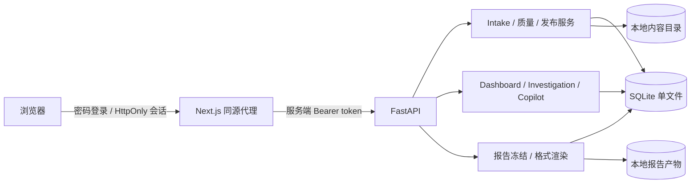
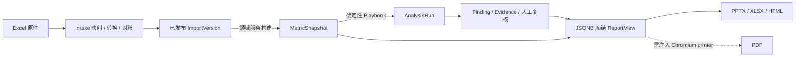

# FLOW 运行架构与部署边界｜2026-10-18

当前目标为单机单用户验证原型，正式决策见 D055。普通使用由本机 Web/API 进程、一个 SQLite 文件和一个本地内容目录组成；历史 Compose 基础设施仅供既有 PostgreSQL 兼容性与 CI 验证使用，不是普通启动路径。

## 进程与责任

| 进程 | 当前责任 | 依赖 |
|---|---|---|
| Next.js Web | 登录、同源代理、导入工作台、驾驶舱、调查、报告中心 | 本机 FastAPI |
| FastAPI API | `/api/v1` 合约与同步领域用例；校验、发布、渲染在请求进程执行 | SQLite、`objects/` |
| SQLite | canonical、版本、血缘、指标、分析、复核、冻结报告与审计 | `~/.flow/flow.sqlite3` |
| 本地内容目录 | 内容寻址的原始文件、报告和导出产物 | `~/.flow/objects/` |

任务在请求进程同步执行；不启动独立任务队列或 Worker。Intake 发布 API 仍只发布 canonical 导入版本，不自动调用指标或分析服务；指标与分析通过显式构建 API `/api/v1/orchestration/batches/{id}/build` 按批次期间同步构建。

## 请求与数据边界

公开财报另由 `statements` 来源/抽取/归一/勾稽/复核模块处理，已提交指标治理使用数据库定义版本、执行绑定及影响沙箱，YAML 按 D048 保留兼容。只有接入模块可以读取原始 Excel。指标和分析服务读取受治理 canonical 数据；Dashboard 读取已发布快照/运行的投影；Investigation 展示数值、源记录与审计；Copilot 使用绑定对象的上下文和输出校验。各模块不能自行创造数字或绕过复核签发。

## 发布能力与恢复

`publishing/publication.py` 同步逐格式创建 `running` 尝试，成功后登记对象，失败记录 `error_message`，最后提交尝试历史。数据库允许 `queued`，但现服务并未实现排队执行。

| 格式/动作 | 当前实现 |
|---|---|
| PPTX / XLSX / HTML | 默认 API 服务已连接确定性渲染器，产物写入本地内容目录 |
| PDF | 冻结 HTML + 可注入 printer 的路径及黄金测试存在；默认 API `PublicationService()` 没有 printer，PDF 尝试会失败 |
| 失败重试 | 对同一冻结报告新建尝试，不重算或修改报告 |
| 下载 | 读取成功尝试的存储字节，核对 SHA-256，使用服务端文件名与 `no-store` / `nosniff` |
| 历史无载荷报告 | 已有产物仍可下载；重新渲染返回 `freeze_blocked`，需按当前合格对象重新冻结 |

不能用四格式黄金测试通过来宣称默认部署已提供 PDF 下载。文件存储验收应检查本地内容寻址、SHA-256 和新目录备份恢复。

## 启动、迁移与配置

| 命令 | 实际作用与边界 |
|---|---|
| `make flow-bootstrap` | 安装构建依赖、生成 Next standalone 生产构建并复制静态资源，随后精简 Web/API 运行依赖 |
| `make bootstrap` | 安装完整开发与测试依赖（包括旧 PostgreSQL/Redis/MinIO 兼容性测试工具） |
| `make flow-init` | 在 `~/.flow` 初始化 SQLite、内容目录和本机开发身份；支持 `FLOW_DATA_DIR` 指定隔离目录 |
| `make flow` | 初始化后启动本机 API 与 Next standalone Web（127.0.0.1:8000、127.0.0.1:3000），并检查两者就绪 |
| `cd services/api && uv run alembic upgrade head` | 历史 PostgreSQL 兼容性链；普通单机运行使用 `scripts/flow.py init` 的 SQLite 专用基线链 |
| `make infra-up` / `make stack-up` | 仅为历史 PostgreSQL/Redis/MinIO 测试栈保留，不用于普通用户启动 |
| `make contracts` / `make contracts-check` | 生成并检查 OpenAPI 与 TypeScript 漂移 |
| `make acceptance` | 七道功能门禁；脚本先删除并重建本地 `public` schema，只能用于隔离演示/测试库 |
| `make test-user-closure-e2e` | 回归加浏览器闭环；监督器清理本次启动的进程组，仍须使用隔离测试库与端口 |

普通启动默认绑定回环地址，只允许本机使用。`FLOW_DATA_DIR` 下的数据库与文件共同构成应用数据；使用系统备份工具或应用备份功能保存数据目录。历史 Compose 栈仍使用开发凭据与暴露端口，不能作为产品运行入口。单用户认证见[认证配置](../operations/authentication.md)。备份恢复及真实数据试点仍需独立验收。

源码入口：[Compose](../../infra/compose.yaml)、[Makefile](../../Makefile)、[API 路由](../../services/api/src/flow_api/api/routes)、[旧 CI Worker 桩](../../services/api/src/flow_api/worker.py)、[发布服务](../../services/api/src/flow_api/publishing/（模块化拆分：four_stage_binding / objective_freeze / objective_renderers）)。
